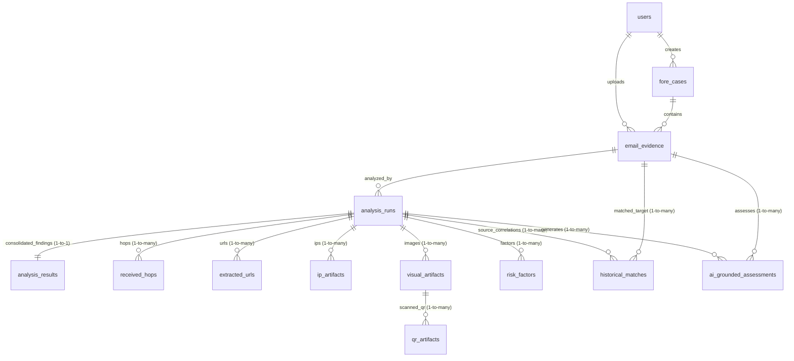

# Email Forensics Database Documentation

Welcome to the beginner-friendly guide for the **Email Forensics** database! This document explains how data is organized, what each table and column represents, and how the different pieces of information connect to one another.

---

## 1. Quick Overview: The 13-Table Architecture

The database is built on **PostgreSQL** and contains **13 application tables** (reduced and simplified from the earlier 15 tables by consolidating one-to-one forensic findings into a single table called `analysis_results`).

Here is a quick look at the easy-to-understand labels for each table:

| SQL Table Name | Friendly Name | What It Stores |
| :--- | :--- | :--- |
| `users` | **Users** | System accounts (investigators, administrators, analysts) who log in and work on forensic cases. |
| `fore_cases` | **Cases** | Investigation case files opened by analysts to group related suspicious emails and evidence. |
| `email_evidence` | **Uploaded Emails** | The original uploaded email files (`.eml`), cryptographic hashes, and core metadata preserved for chain of custody. |
| `analysis_runs` | **Analysis Attempts** | Individual execution attempts and progress tracking for the forensic analysis pipeline. |
| `analysis_results` | **Analysis Results** | Consolidated forensic findings (headers, content machine learning/heuristics, and deterministic risk score) for an analysis run. |
| `received_hops` | **Email Route** | The hop-by-hop journey of the email across mail transfer agents (MTAs) extracted from `Received` headers. |
| `extracted_urls` | **URLs** | Links found inside the email body, anchor text mismatches, and domain intelligence. |
| `ip_artifacts` | **IP Addresses** | Network IP addresses discovered in email headers and route hops. |
| `visual_artifacts` | **Images** | Embedded inline pictures and attachments extracted from the email. |
| `qr_artifacts` | **QR Codes** | QR codes detected within visual artifacts and their decoded URLs/payloads (Quishing defense). |
| `risk_factors` | **Risk Reasons** | Specific forensic red flags and positive indicators contributing to the final risk score. |
| `historical_matches` | **Previous Email Matches** | Cross-case correlations identifying similar threat campaigns and recurring indicators. |
| `ai_grounded_assessments` | **AI Assessments** | AI-generated threat evaluations with strict citations to verified forensic evidence. |

---

## 2. How the Tables Are Connected (Relationships)

Understanding how records connect is simple once you see the investigation workflow:

### Key Relational Rules:
1. **Case to Email:** One Case (`fore_cases`) can contain many Uploaded Emails (`email_evidence`).
2. **Email to Analysis Attempts:** One Uploaded Email can have multiple Analysis Attempts (`analysis_runs`), such as when an analyst retries analysis after a network hiccup or configuration change.
3. **Attempt to Results (1-to-1 Consolidation):** Each Analysis Attempt has exactly **one** consolidated Analysis Result record (`analysis_results`). The `analysis_run_id` serves as both the **primary key** and the **foreign key** to prevent duplicate or conflicting result rows.
4. **Attempt to Multi-Item Findings (1-to-Many):** An Analysis Attempt can discover many route hops (`received_hops`), many links (`extracted_urls`), many IP addresses (`ip_artifacts`), many images (`visual_artifacts`), and many risk reasons (`risk_factors`).
5. **Image to QR Code:** When an image (`visual_artifacts`) contains a QR code, the decoded data is stored in `qr_artifacts`, linked by `visual_artifact_id`.

---

## 3. Detailed Table & Column Reference

### 1. `users` — Users
Stores system accounts, passwords, and assigned roles.

| Column Name | Type | Description |
| :--- | :--- | :--- |
| `id` | `UUID` | Unique identifier for each user account (Primary Key). |
| `username` | `VARCHAR` | Login username (e.g., `analyst`, `admin`). Must be unique. |
| `email` | `VARCHAR` | User's work email address. Must be unique. |
| `password_hash` | `VARCHAR` | Securely hashed password (BCrypt). Plaintext passwords are never stored. |
| `role` | `VARCHAR` | User authorization role (e.g., `ROLE_ANALYST`, `ROLE_ADMIN`). |
| `enabled` | `BOOLEAN` | `true` if the account is active; `false` if deactivated. |
| `created_at` | `TIMESTAMP WITH TIME ZONE` | Exact date and time the user account was created. |

---

### 2. `fore_cases` — Cases
Stores investigation case dossiers.

| Column Name | Type | Description |
| :--- | :--- | :--- |
| `id` | `UUID` | Unique identifier for the case (Primary Key). |
| `case_number` | `VARCHAR` | Human-readable case code (e.g., `CASE-2026-0001`). Must be unique. |
| `title` | `VARCHAR` | Short descriptive title of the investigation. |
| `description` | `TEXT` | Detailed context or background of why this case was opened. |
| `status` | `VARCHAR` | Current workflow state of the case (e.g., `OPEN`, `IN_PROGRESS`, `CLOSED`). |
| `analyst_notes` | `TEXT` | Free-form notes and findings written by the investigating analyst. |
| `created_by` | `UUID` | Reference to the `users(id)` who created this case (Foreign Key). |
| `created_at` | `TIMESTAMP WITH TIME ZONE` | Timestamp when the case was created. |
| `updated_at` | `TIMESTAMP WITH TIME ZONE` | Timestamp when the case was last modified. |

---

### 3. `email_evidence` — Uploaded Emails
Stores the original email evidence file, cryptographic hashes, and core sender metadata.

| Column Name | Type | Description |
| :--- | :--- | :--- |
| `id` | `UUID` | Unique identifier for the uploaded email (Primary Key). |
| `case_id` | `UUID` | Reference to the `fore_cases(id)` this email belongs to (Foreign Key). |
| `original_filename` | `VARCHAR` | Original file name as provided during upload (e.g., `suspicious-invoice.eml`). |
| `storage_key` | `VARCHAR` | Unique internal reference/path where the raw RFC 822 file is stored in the evidence vault. |
| `file_size_bytes` | `BIGINT` | Exact size of the raw uploaded email file in bytes. |
| `sha256_hash` | `CHAR(64)` | 64-character SHA-256 cryptographic checksum ensuring evidence integrity and tamper resistance. |
| `subject` | `TEXT` | Email subject line extracted from headers. |
| `message_id` | `VARCHAR` | Standard RFC 822 `Message-ID` header value. |
| `sent_date` | `TIMESTAMP WITH TIME ZONE` | Date and time the email claims to have been sent. |
| `uploaded_by` | `UUID` | Reference to the `users(id)` who uploaded this email (Foreign Key). |
| `uploaded_at` | `TIMESTAMP WITH TIME ZONE` | Exact date and time the email was received and vaulted. |

---

### 4. `analysis_runs` — Analysis Attempts
Tracks execution progress, state machine status, and error details for each analysis attempt.

| Column Name | Type | Description |
| :--- | :--- | :--- |
| `id` | `UUID` | Unique identifier for this analysis run attempt (Primary Key). |
| `email_id` | `UUID` | Reference to the `email_evidence(id)` being analyzed (Foreign Key). |
| `pipeline_version` | `VARCHAR` | Version of the analysis pipeline software used (e.g., `1.0.0`). |
| `status` | `VARCHAR` | Overall state of this attempt: `QUEUED`, `RUNNING`, `COMPLETED`, or `FAILED`. |
| `current_stage` | `VARCHAR` | Active processing phase (e.g., `MIME_PARSING`, `HEADER_ANALYSIS`, `CONTENT_ANALYSIS`, `RISK_SCORING`, `COMPLETED`). |
| `attempt_number` | `INTEGER` | Run attempt counter (e.g., 1 for initial run, 2 for first retry). |
| `started_at` | `TIMESTAMP WITH TIME ZONE` | Timestamp when this analysis run started processing. |
| `completed_at` | `TIMESTAMP WITH TIME ZONE` | Timestamp when processing concluded (either success or failure). |
| `error_code` | `VARCHAR` | System error classification code if the run failed. |
| `safe_error_message` | `TEXT` | Sanitized, analyst-safe error explanation avoiding sensitive internal stack traces. |
| `created_at` | `TIMESTAMP WITH TIME ZONE` | Timestamp when this attempt was queued. |

---

### 5. `analysis_results` — Analysis Results
The consolidated table storing all primary forensic outputs for an analysis attempt: email headers, content machine learning & heuristics, and deterministic risk scoring.

| Column Name | Type | Category | Description |
| :--- | :--- | :--- | :--- |
| `analysis_run_id` | `UUID` | **Key** | Primary Key & Foreign Key to `analysis_runs(id)`. Guarantees exactly one result record per attempt. |
| `header_result_id` | `UUID` | Header | Preserved original ID for header findings (used by existing DTOs). |
| `from_address` | `VARCHAR` | Header | Normalized sender address from the `From` header. |
| `from_domain` | `VARCHAR` | Header | Domain extracted from the sender address (e.g., `company.com`). |
| `reply_to` | `VARCHAR` | Header | Address specified in the `Reply-To` header. |
| `return_path` | `VARCHAR` | Header | Address specified in the `Return-Path` header (bounce address). |
| `dkim_domain` | `VARCHAR` | Header | Signing domain extracted from `DKIM-Signature` or `Authentication-Results`. |
| `reported_spf` | `VARCHAR` | Header | SPF status reported by the receiving MTA (`PASS`, `FAIL`, `SOFTFAIL`, `NONE`). |
| `reported_dkim` | `VARCHAR` | Header | DKIM status reported by the receiving MTA (`PASS`, `FAIL`, `NONE`). |
| `reported_dmarc` | `VARCHAR` | Header | DMARC status reported by the receiving MTA (`PASS`, `FAIL`, `NONE`). |
| `reported_arc` | `VARCHAR` | Header | Authenticated Received Chain status (`PASS`, `FAIL`, `NONE`). |
| `current_dns_observation` | `TEXT` | Header | Live active DNS lookup findings for SPF, DKIM, and DMARC records. |
| `independent_verification` | `TEXT` | Header | Active verification notes explaining DNS vs header consistency. |
| `identity_mismatch_flags` | `TEXT` | Header | List of flags indicating spoofing (e.g., `FROM_REPLY_TO_MISMATCH`, `DISPLAY_NAME_SPOOFING`). |
| `raw_headers_json` | `TEXT` | Header | Complete parsed headers stored in structured JSON format for deep inspection. |
| `header_created_at` | `TIMESTAMP WITH TIME ZONE` | Header | Timestamp when header evaluation completed. |
| `content_result_id` | `UUID` | Content | Preserved original ID for content analysis (mapped to `ContentAnalysisDto.id`). |
| `ml_model_version` | `VARCHAR` | Content | Machine learning model identifier (e.g., `tribuo-logreg-tfidf-v1.0.0`). |
| `probability` | `DOUBLE PRECISION` | Content | Phishing probability score calculated by the ML model (from `0.0` to `1.0`). |
| `predicted_label` | `VARCHAR` | Content | Classification label (`BENIGN` or `PHISHING`). |
| `ml_status` | `VARCHAR` | Content | Execution status of ML evaluation (`EVALUATED`, `SKIPPED`, `FAILED`). |
| `urgency` | `BOOLEAN` | Content | `true` if urgent language or artificial deadlines are detected. |
| `credential_request` | `BOOLEAN` | Content | `true` if text solicits passwords, PINs, or credentials. |
| `payment_instruction` | `BOOLEAN` | Content | `true` if wire transfers, crypto payments, or gift cards are requested. |
| `impersonation` | `BOOLEAN` | Content | `true` if impersonation of leadership, IT support, or trusted brands is detected. |
| `secrecy` | `BOOLEAN` | Content | `true` if confidentiality demands (e.g., "don't tell anyone") are present. |
| `prompt_injection_detected` | `BOOLEAN` | Content | `true` if malicious AI prompt injection patterns were found in email text. |
| `prompt_matches` | `JSONB` | Content | JSON array of detected prompt injection pattern matches. |
| `social_engineering_matches` | `JSONB` | Content | JSON array of specific keywords and phrases triggering social engineering flags. |
| `content_created_at` | `TIMESTAMP WITH TIME ZONE` | Content | Timestamp when content analysis completed. |
| `risk_result_id` | `UUID` | Risk | Preserved original ID for the risk assessment. |
| `deterministic_risk_score` | `INTEGER` | Risk | Final capped risk score from `0` (clean) to `100` (critical threat). |
| `risk_level` | `VARCHAR` | Risk | Human-friendly threat category (`LOW`, `MEDIUM`, `HIGH`, `CRITICAL`). |
| `evidence_confidence_score` | `INTEGER` | Risk | Confidence score (from `0` to `100`) based on breadth of available evidence channels. |
| `confidence_level` | `VARCHAR` | Risk | Confidence tier (`LOW`, `MEDIUM`, `HIGH`). |
| `confidence_explanation` | `TEXT` | Risk | Clear narrative explaining why the system is confident or uncertain about the score. |
| `category_scores_json` | `JSONB` | Risk | JSON breakdown of points scored across each category (Headers, Content, URLs, etc.). |
| `total_uncapped_score` | `INTEGER` | Risk | Raw sum of risk points before applying the 100-point cap. |
| `engine_version` | `VARCHAR` | Risk | Rule engine calculation version (e.g., `v1.0.0`). |
| `evaluated_at` | `TIMESTAMP WITH TIME ZONE` | Risk | Timestamp when risk evaluation was completed. |
| `risk_created_at` | `TIMESTAMP WITH TIME ZONE` | Risk | Timestamp when the risk assessment record was saved. |

---

### 6. `received_hops` — Email Route
Tracks the relay servers that forwarded the email message from source to recipient.

| Column Name | Type | Description |
| :--- | :--- | :--- |
| `id` | `UUID` | Unique identifier for this hop entry (Primary Key). |
| `analysis_run_id` | `UUID` | Reference to `analysis_runs(id)` (Foreign Key). |
| `hop_order` | `INTEGER` | Step number in the path (e.g., 1 is first relay, 2 is second, etc.). |
| `from_host` | `VARCHAR` | Hostname sending the message in this hop. |
| `by_host` | `VARCHAR` | Hostname receiving the message in this hop. |
| `protocol` | `VARCHAR` | Protocol used (e.g., `ESMTP`, `HTTP`). |
| `hop_ip` | `VARCHAR` | IP address of the sending server for this hop. |
| `hop_timestamp` | `TIMESTAMP WITH TIME ZONE` | Date/time recorded in this hop's `Received` header. |
| `delay_seconds` | `BIGINT` | Seconds of delay between this hop and the previous hop. |
| `raw_hop_line` | `TEXT` | Complete original `Received` header line. |
| `parsing_warning` | `VARCHAR` | Notes if the hop header had non-standard formatting. |
| `created_at` | `TIMESTAMP WITH TIME ZONE` | Timestamp when this hop was parsed. |

---

### 7. `extracted_urls` — URLs
Stores every hyperlink discovered in the email body.

| Column Name | Type | Description |
| :--- | :--- | :--- |
| `id` | `UUID` | Unique identifier for this URL (Primary Key). |
| `analysis_run_id` | `UUID` | Reference to `analysis_runs(id)` (Foreign Key). |
| `raw_url` | `TEXT` | Exact link destination URL as found in HTML or plain text. |
| `normalized_url` | `TEXT` | Cleaned and canonicalized URL for consistent matching. |
| `domain` | `VARCHAR` | Extracted hostname/domain name from the URL. |
| `source_type` | `VARCHAR` | Where the link was found (e.g., `HTML_HREF`, `PLAIN_TEXT`, `QR_CODE`). |
| `anchor_text` | `TEXT` | Visible text shown to the user in the email body. |
| `anchor_mismatch` | `BOOLEAN` | `true` if visible text shows one domain but the link points to a different domain. |
| `is_ip_url` | `BOOLEAN` | `true` if the URL uses a direct IP address instead of a domain name. |
| `is_shortened` | `BOOLEAN` | `true` if a known URL shortener was used (e.g., `bit.ly`, `tinyurl.com`). |
| `unusual_port` | `BOOLEAN` | `true` if non-standard ports (such as `:8080` or `:4444`) are specified. |
| `subdomain_excess` | `BOOLEAN` | `true` if excessive subdomains are used to disguise the real domain. |
| `lookalike` | `BOOLEAN` | `true` if homoglyphs or typosquatting domain impersonation is detected. |
| `dns_status` | `VARCHAR` | Resolution status (`RESOLVED`, `NXDOMAIN`, `LOOKUP_FAILED`). |
| `url_risk_score` | `INTEGER` | Risk score calculated for this specific link. |
| `data_mode` | `VARCHAR` | Operational mode (`REAL` or `OFFLINE_MOCK`). |
| `created_at` | `TIMESTAMP WITH TIME ZONE` | Timestamp when this URL was extracted. |

---

### 8. `ip_artifacts` — IP Addresses
Stores public and private IP addresses identified during analysis.

| Column Name | Type | Description |
| :--- | :--- | :--- |
| `id` | `UUID` | Unique identifier for this IP entry (Primary Key). |
| `analysis_run_id` | `UUID` | Reference to `analysis_runs(id)` (Foreign Key). |
| `ip_address` | `VARCHAR` | IPv4 or IPv6 address string. |
| `source_context` | `VARCHAR` | Where the IP was discovered (e.g., `RECEIVED_HEADER`, `URL_RESOLVED`). |
| `is_private` | `BOOLEAN` | `true` if the IP is a local/private network address (RFC 1918). |
| `lookup_status` | `VARCHAR` | Status of network intelligence checks (`COMPLETED`, `SKIPPED`). |
| `data_mode` | `VARCHAR` | Operational mode (`REAL` or `OFFLINE_MOCK`). |
| `observed_at` | `TIMESTAMP WITH TIME ZONE` | When this IP was recorded in the message transmission. |
| `created_at` | `TIMESTAMP WITH TIME ZONE` | Timestamp when this record was saved. |

---

### 9. `visual_artifacts` — Images
Stores references to embedded images and visual attachments.

| Column Name | Type | Description |
| :--- | :--- | :--- |
| `id` | `UUID` | Unique identifier for this visual artifact (Primary Key). |
| `analysis_run_id` | `UUID` | Reference to `analysis_runs(id)` (Foreign Key). |
| `filename` | `VARCHAR` | File name of the image (e.g., `qr_code.png`, `logo.jpg`). |
| `content_type` | `VARCHAR` | MIME type of the image (e.g., `image/png`, `image/jpeg`). |
| `file_size_bytes` | `BIGINT` | Size of the image file in bytes. |
| `sha256_hash` | `CHAR(64)` | SHA-256 cryptographic hash of the image file. |
| `processing_error` | `TEXT` | Any error encountered during image decoding or processing. |
| `data_mode` | `VARCHAR` | Operational mode (`REAL` or `OFFLINE_MOCK`). |
| `created_at` | `TIMESTAMP WITH TIME ZONE` | Timestamp when this image was extracted. |

---

### 10. `qr_artifacts` — QR Codes
Stores QR codes scanned inside images to defend against QR phishing ("Quishing").

| Column Name | Type | Description |
| :--- | :--- | :--- |
| `id` | `UUID` | Unique identifier for this QR record (Primary Key). |
| `visual_artifact_id` | `UUID` | Reference to the `visual_artifacts(id)` that contained this QR code (Foreign Key). |
| `decoded_payload` | `TEXT` | Raw text, URL, or data decoded from the QR code. |
| `payload_type` | `VARCHAR` | Type of payload (e.g., `URL`, `TEXT`, `WIFI_CONFIG`). |
| `normalized_url` | `TEXT` | Normalized URL if the payload is a web link. |
| `created_at` | `TIMESTAMP WITH TIME ZONE` | Timestamp when the QR code was decoded. |

---

### 11. `risk_factors` — Risk Reasons
Itemized forensic reasons contributing to the deterministic risk calculation.

| Column Name | Type | Description |
| :--- | :--- | :--- |
| `id` | `UUID` | Unique identifier for this factor (Primary Key). |
| `analysis_run_id` | `UUID` | Reference to `analysis_runs(id)` (Foreign Key). |
| `category` | `VARCHAR` | Threat channel (`AUTHENTICATION`, `IDENTITY`, `URL`, `CONTENT`, `VISUAL`, `MACHINE_LEARNING`). |
| `factor_code` | `VARCHAR` | Machine-readable rule code (e.g., `AUTH_SPF_FAIL`, `URL_ANCHOR_MISMATCH`). |
| `severity` | `VARCHAR` | Factor impact level (`LOW`, `MEDIUM`, `HIGH`, `CRITICAL`). |
| `weight_points` | `INTEGER` | Number of risk points added (or subtracted) by this factor. |
| `explanation` | `TEXT` | Clear plain-English explanation of why this factor was flagged. |
| `evidence_reference` | `VARCHAR` | Specific evidence item (e.g., `spf=fail`, `url=http://evil.com`) supporting the factor. |
| `created_at` | `TIMESTAMP WITH TIME ZONE` | Timestamp when this risk factor was evaluated. |

---

### 12. `historical_matches` — Previous Email Matches
Cross-case correlations linking the current email to previous threats.

| Column Name | Type | Description |
| :--- | :--- | :--- |
| `id` | `UUID` | Unique identifier for this correlation (Primary Key). |
| `source_run_id` | `UUID` | Reference to `analysis_runs(id)` of the email currently being analyzed (Foreign Key). |
| `matched_email_id` | `UUID` | Reference to `email_evidence(id)` of the previously investigated email (Foreign Key). |
| `matched_case_number` | `VARCHAR` | Case number where the matching email was found (e.g., `CASE-2026-0004`). |
| `matched_case_title` | `VARCHAR` | Title of the case containing the match. |
| `correlation_type` | `VARCHAR` | What matched (e.g., `IDENTICAL_HASH`, `SAME_SENDER_DOMAIN`, `SHARED_MALICIOUS_URL`). |
| `matched_value` | `TEXT` | Specific indicator value that matched across emails. |
| `match_strength` | `VARCHAR` | Confidence in the correlation (`EXACT`, `HIGH`, `MEDIUM`). |
| `match_explanation` | `TEXT` | Narrative explaining how this match connects to prior threat activity. |
| `created_at` | `TIMESTAMP WITH TIME ZONE` | Timestamp when the correlation was discovered. |

---

### 13. `ai_grounded_assessments` — AI Assessments
AI-assisted threat assessments grounded strictly in verified forensic evidence.

| Column Name | Type | Description |
| :--- | :--- | :--- |
| `id` | `UUID` | Unique identifier for the AI assessment (Primary Key). |
| `email_evidence_id` | `UUID` | Reference to `email_evidence(id)` (Foreign Key). |
| `analysis_run_id` | `UUID` | Reference to `analysis_runs(id)` (Foreign Key). |
| `provider` | `VARCHAR` | AI service provider used (e.g., `groq`, `fallback`). |
| `model_name` | `VARCHAR` | AI model name (e.g., `llama-3.3-70b-versatile`). |
| `prompt_version` | `VARCHAR` | Version of the grounded forensic prompt template. |
| `status` | `VARCHAR` | Assessment status (`LIVE_AI`, `GROUNDED_FALLBACK`, `FAILED`). |
| `threat_classification` | `VARCHAR` | AI classification (`BENIGN`, `SUSPICIOUS`, `PHISHING`, `MALICIOUS`). |
| `confidence_assessment` | `VARCHAR` | AI confidence tier (`HIGH`, `MEDIUM`, `LOW`). |
| `summary_explanation` | `TEXT` | Concise summary of findings written for the analyst. |
| `key_indicators_json` | `JSONB` | JSON array of key forensic indicators evaluated by the AI. |
| `evidence_references_json` | `JSONB` | JSON array of citations to verified evidence items in the database. |
| `unsupported_references_json` | `JSONB` | Disallowed claims flagged by the anti-hallucination grounder. |
| `limitations_and_caveats` | `TEXT` | Notes on missing evidence or limitations in the analysis. |
| `untrusted_injections_detected` | `BOOLEAN` | `true` if prompt injection was detected in the email body and neutralized. |
| `sanitized_context_summary` | `TEXT` | Cleaned evidence summary provided to the model. |
| `error_message` | `TEXT` | Error details if provider call failed or fallback was triggered. |
| `tokens_used` | `INTEGER` | Number of tokens consumed by the AI request. |
| `generation_time_ms` | `BIGINT` | Time in milliseconds taken to generate the assessment. |
| `created_at` | `TIMESTAMP WITH TIME ZONE` | Timestamp when this assessment was generated. |

---

## 4. Key Takeaways for Developers & Analysts

1. **Simpler & Faster:** By consolidating the old `header_analysis`, `content_analysis`, and `risk_assessments` tables into `analysis_results`, queries for investigation dashboards now join one table instead of three.
2. **Strict Foreign Keys:** Every finding references its parent `analysis_runs(id)`, which in turn references `email_evidence(id)`. This prevents orphaned records and keeps data consistent.
3. **Auditability & Chain of Custody:** The raw email file is immutable in the vault, verified by its `sha256_hash`, and all derived findings link back to the exact run that produced them.

