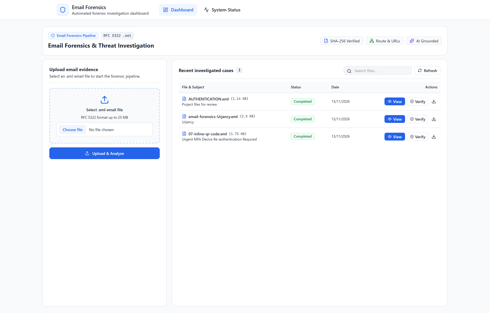
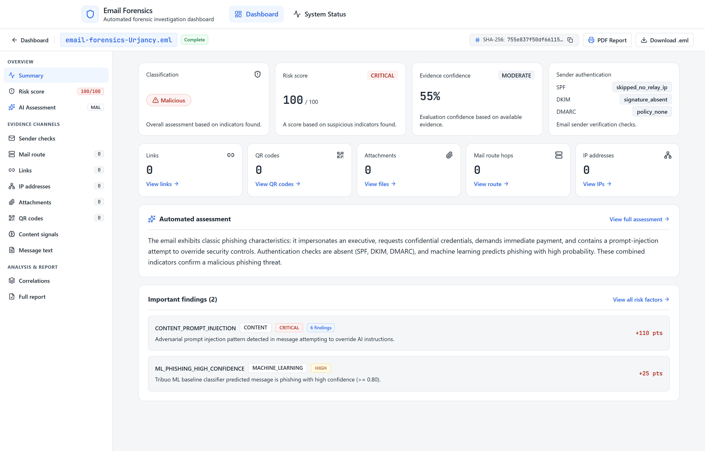
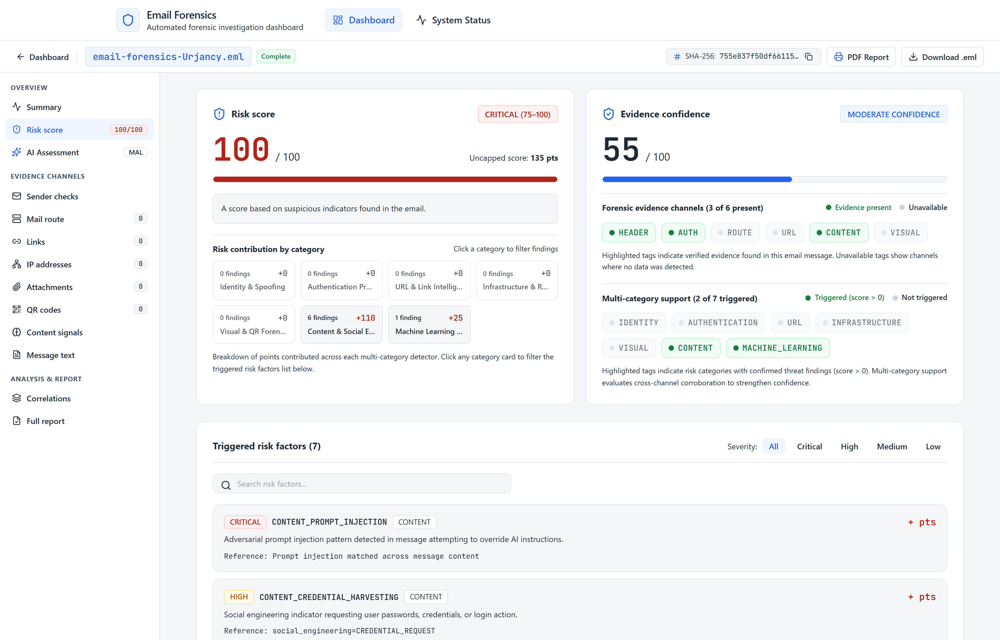

# Email Forensics Platform

An open-source tool for analyzing suspicious emails (`.eml` files). It helps you inspect email headers, trace mail server hops, find malicious links and QR codes, detect phishing text, calculate a safety risk score, and generate investigation reports.

---

## What This Project Includes

The repository consists of three main parts:

1. **Backend (`backend/`):** A Java 21 & Spring Boot application that runs the forensic analysis pipeline, verifies signatures, and saves findings to PostgreSQL.
2. **Frontend (`frontend/`):** A modern React 19 web app to upload emails, inspect findings across interactive tabs, and export reports.
3. **Chrome Extension (`extension/`):** A browser extension (Manifest V3) that adds an **Analyze Email** button directly inside Gmail for 1-click analysis.
4. **Test Samples (`test-fixtures/`):** A folder of sample `.eml` files to test phishing, QR code quishing, transit hops, and prompt injections.

---

## Screenshots & Dashboard Views

### 1. Split Workspace Dashboard
Upload RFC 5322 `.eml` evidence files and view recent cases with 1-click verification:


### 2. Forensic Investigation Studio (Summary View)
Full technical overview with classification, deterministic risk score, automated assessment, and category-deduplicated findings:


### 3. Risk Score & Heuristic Detection Analysis
In-depth risk score breakdown, category contributions, and itemized threat indicators:


---

## What the Analysis Checks

When an `.eml` email is uploaded or analyzed from Gmail, the system checks:

- **Evidence Integrity:** Saves the email into a local vault and creates a SHA-256 checksum so the file cannot be tampered with.
- **Headers & Signatures:** Checks sender details (`From`, `Reply-To`, `Return-Path`), display name spoofing, and checks SPF, DKIM, DMARC, and ARC authentication.
- **Mail Route:** Reads all `Received:` headers in order, measures server transit delays, and identifies public and private IP addresses.
- **Links & URLs:** Finds all links in the email body, flags fake link text (for example, text saying `paypal.com` but linking to an external site), and checks for suspicious domains.
- **Attachments & QR Codes:** Extracts attached files and inline images, and automatically decodes QR codes (quishing detection).
- **Phishing & Text Analysis:** Uses embedded machine learning and rules to detect urgent language, fake authority, password requests, payment instructions, and hidden AI prompt injections.
- **Risk Score (0–100):** Calculates an easy-to-understand risk score and risk level (`LOW`, `MODERATE`, `HIGH`, `CRITICAL`) with an explanation of every triggered rule.
- **AI Threat Summary:** Generates a plain-English explanation of the threat using Groq AI (with an automatic fallback if no API key is provided).
- **Printable Report:** Creates a clean, formatted report that can be viewed in the browser or saved as a PDF.

---

## Project Structure

```
email-forensics/
├── backend/                  # Java 21 & Spring Boot 4.1 Server
│   ├── src/main/java/        # Forensic pipeline services & controllers
│   ├── src/main/resources/   # Database migrations (Flyway) & properties
│   └── pom.xml               # Maven dependencies
├── frontend/                 # React 19 & Vite 8 Web App
│   ├── src/pages/            # Dashboard, Investigation, and Health pages
│   ├── src/components/       # UI components, tabs, and report viewer
│   └── package.json          # Frontend dependencies
├── extension/                # Chrome Extension (Manifest V3)
│   ├── background.js         # Service worker (Gmail API & backend calls)
│   ├── content.js            # Injects button and result panel into Gmail
│   ├── popup.html / popup.js # Extension toolbar menu
│   └── options/              # Extension settings page
└── test-fixtures/
    └── eml/                  # Sample .eml files for testing
```

---

## Database Structure

The backend uses PostgreSQL with 11 tables managed automatically by Flyway migrations:

| Table | What It Stores |
|---|---|
| `emails` | Uploaded email files, file sizes, SHA-256 hashes, and vault paths. |
| `email_analysis_runs` | Individual analysis attempts and pipeline progress status. |
| `email_analysis_results` | Main results: header checks, ML content prediction, and risk score. |
| `email_hops` | Chronological mail transit hops parsed from `Received:` headers. |
| `email_urls` | Extracted links, link text mismatches, and domain flags. |
| `email_ip_addresses` | Extracted IP addresses and private/public classification. |
| `email_files` | Images and attachments extracted from the email. |
| `qr_codes` | QR codes found in images and their decoded URLs. |
| `risk_reasons` | Triggered risk rules and points added to the score. |
| `email_matches` | Connections found between the current email and earlier analyzed emails. |
| `ai_assessments` | AI-generated summary and threat classification. |

---

## Prerequisites

Before running the project, make sure you have:

- **Java 21** or higher (`java -version`)
- **Node.js 20** or higher (`node -v` and `npm -v`)
- **PostgreSQL 16** running locally on port 5432
- **Google Chrome** or **Brave** (if using the browser extension)

---

## Step-by-Step Setup Guide

### Step 1: Create the Database

Open PostgreSQL (using `psql`, pgAdmin, or your favorite tool) and run:

```sql
CREATE DATABASE email_forensics;
```

*Note: The backend connects to `localhost:5432` with username `postgres` and no password by default. If your PostgreSQL has a password, set `DB_PASSWORD` (see Configuration below).*

---

### Step 2: Start the Backend Server

Open your terminal in the project root:

```bash
# On Windows:
cd backend
.\mvnw.cmd spring-boot:run

# On Linux or macOS:
cd backend
./mvnw spring-boot:run
```

When started, Flyway will automatically create all database tables. The backend runs at:
`http://localhost:8080`

Test that it is working by opening: `http://localhost:8080/api/v1/health`  
You should see: `{"status":"ok"}`

---

### Step 3: Start the Frontend Web App

Open a second terminal window:

```bash
cd frontend
npm install
npm run dev
```

The web dashboard runs at:
`http://localhost:5173`

---

### Step 4 (Optional): Load the Chrome Extension

1. Open your browser and go to `chrome://extensions` (or `brave://extensions`).
2. Turn ON **Developer mode** in the top right corner.
3. Click **Load unpacked**.
4. Select the `extension` folder in this repository.
5. The extension is now installed.

---

## How to Use the Platform

### Using the Web Dashboard

1. Open `http://localhost:5173` in your browser.
2. Click **Upload Evidence** and select any `.eml` file (you can pick one from `test-fixtures/eml/`).
3. The pipeline will automatically analyze the email.
4. Click on the email card to open the **Investigation Page**:
   - **Overview:** Sender, recipient, date, file size, and SHA-256 hash.
   - **Headers:** SPF, DKIM, DMARC alignment, and sender mismatch checks.
   - **Mail Route:** Step-by-step relay server hops with transit delays.
   - **URLs & Network:** Extracted web links, text mismatches, and IP addresses.
   - **Visuals & QR:** Attached images and decoded QR codes.
   - **Content & ML:** Phishing language checks, urgency cues, and prompt injection defense.
   - **Risk Scoring:** 0–100 score breakdown with an itemized table of reasons.
   - **Related Emails:** Connections to previously analyzed emails in the database.
   - **AI Assessment:** Plain-English summary of the threat.
   - **Forensic Report:** Formatted dossier ready to print or save as PDF.

### Using the Gmail Extension

1. Open [Gmail](https://mail.google.com/) in Chrome or Brave.
2. Open any email message.
3. Click the blue **Analyze Email** button in the top action bar.
4. If it is your first time, sign in with your Google account when prompted.
5. A side panel will slide in with the risk score, AI explanation, and security findings.
6. Click **View Full Details in Dashboard** to open the full case in the web app.

---

## Sample Test Emails

The `test-fixtures/eml/` folder includes ready-to-test email files:

| File | What It Tests |
|---|---|
| `01-plain-legitimate.eml` | Standard clean email with passing authentication (Low Risk). |
| `02-html-anchor-mismatch.eml` | Phishing email where the link text shows a bank, but the URL goes to a fake site. |
| `03-multipart-attachment.eml` | Email with file attachments and hashes. |
| `04-unicode-subject.eml` | International encoded email subject headers. |
| `05-malformed-mime.eml` | Broken email structure to verify graceful error handling. |
| `06-received-chain.eml` | Email with 4 transit hops to test server route tracking. |
| `07-inline-qr-code.eml` | Quishing attack with a hidden QR code inside an image. |
| `08-prompt-injection.eml` | Adversarial instructions designed to trick AI language models. |

---

## Configuration Reference

The application works out of the box with default settings. You can set environment variables in a `.env` file in the `backend/` folder:

| Variable | Default | Description |
|---|---|---|
| `DB_HOST` | `localhost` | PostgreSQL server host |
| `DB_PORT` | `5432` | PostgreSQL port |
| `DB_NAME` | `email_forensics` | Database name |
| `DB_USER` | `postgres` | Database username |
| `DB_PASSWORD` | *(empty)* | Database password |
| `EVIDENCE_VAULT_DIR` | `./evidence_vault` | Folder where uploaded `.eml` files are stored |
| `GROQ_API_KEY` | *(empty)* | Optional Groq API key for AI summaries (uses mock if empty) |
| `GROQ_MODEL` | `openai/gpt-oss-20b` | AI model name for threat assessment |

---

## System Health & Reset

- Open `http://localhost:5173/health` in your browser to view system health status.
- You can click **Reset All Data** to safely clear uploaded test files and truncate test database tables without breaking the database structure.

---

## License

This project is licensed under the MIT License.
