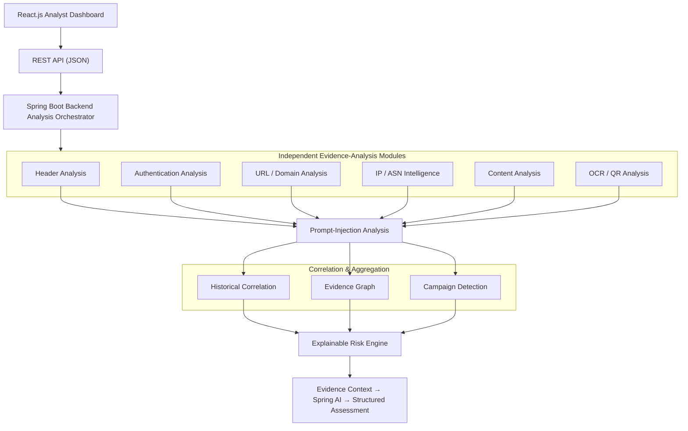
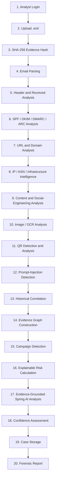
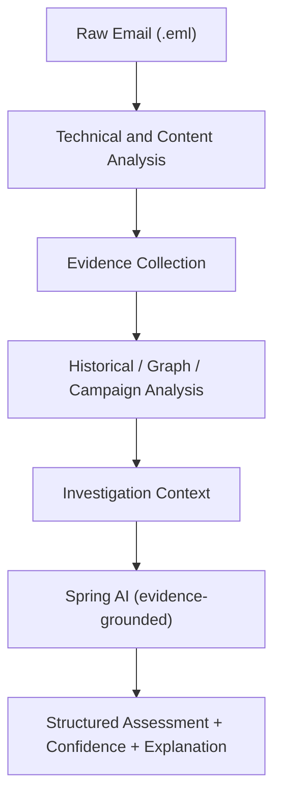
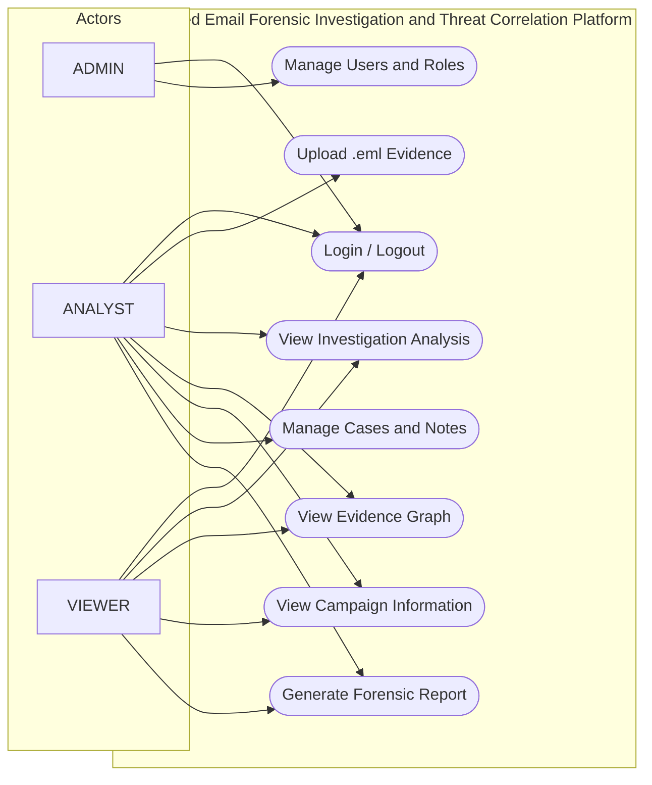
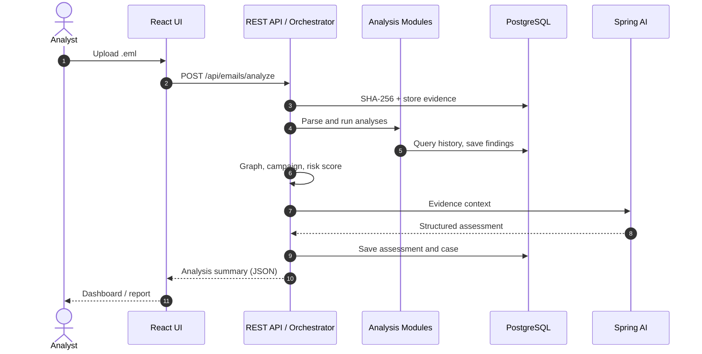
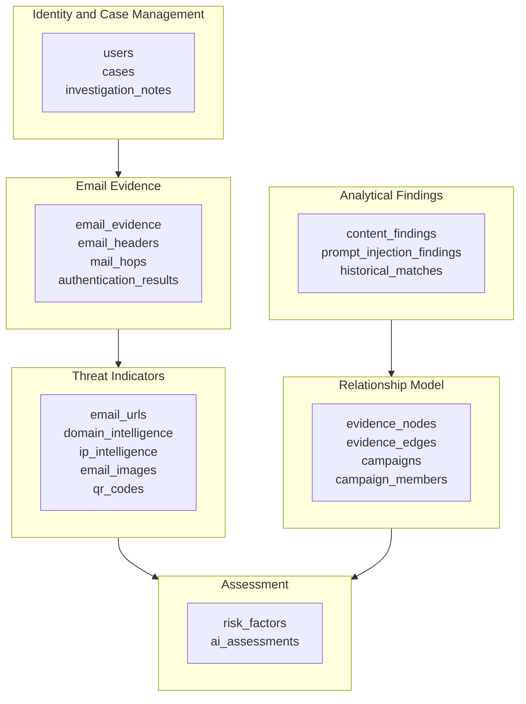
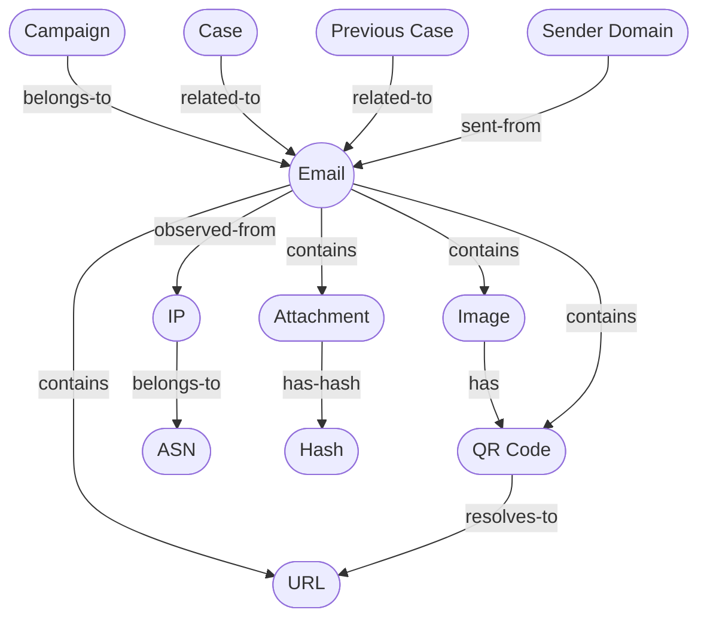

# PROJECT TITLE
# AI-POWERED EMAIL FORENSIC INVESTIGATION AND THREAT CORRELATION

**Shivaji University, Kolhapur**  
Affiliated  

**DR. D. Y. PATIL PRATISHTHAN’S COLLEGE OF ENGINEERING**  
Salokhenagar, Kolhapur – 416007, Maharashtra  
**DEPARTMENT OF COMPUTER SCIENCE AND ENGINEERING**  

## FINAL YEAR PROJECT REPORT

**Project Group No.:** 6  

**Team Members name:**  
- Aniket Deepak Lohar  
- Sagar Kumar Shelake  
- Omkar Ravindra Patil  
- Mohammad Umar Khaja Patel  
- Sakshi Ekanath Patil  

**Project Guide:** Ms. Vanashri. S. Shinde  
**Head of Department:** Dr. Mahesh P. Gaikwad  

**Academic Year 2026–27**  

---

## CERTIFICATE

This is to certify that the project entitled **“AI-Powered Email Forensic Investigation and Threat Correlation”** has been carried out by Aniket Deepak Lohar, Sagar Kumar Shelake, Omkar Ravindra Patil, Mohammad Umar Khaja Patel, Sakshi Ekanath Patil of the Department of Computer Science and Engineering, Dr. D. Y. Patil Pratishthan’s College of Engineering, Salokhenagar, Kolhapur, during Academic Year 2026–27. The work has been carried out under the guidance of Prof. Ms. Vanashri S. Shinde and is submitted in partial fulfillment of the academic requirements of the B. Tech Program.

| Project Guide | Department Academic Coordinator | Head of Department |
| :--- | :--- | :--- |
| Ms. Vanashri S. Shinde | Dr. Rohit S. Barwade | Dr. Mahesh P. Gaikwad |
| Signature & Date | Signature & Date | Signature & Date |

---

## DECLARATION

We hereby declare that the project work **“AI-Powered Email Forensic Investigation and Threat Correlation”** presented in this report is our original work carried out under the guidance of the project guide. The work has not been submitted previously, in whole or in part, for any other academic award. All sources, published works, standards, and other materials used in the project have been appropriately acknowledged.

| Name of Student | Roll No. | Signature |
| :--- | :--- | :--- |
| Aniket Deepak Lohar | 328 | |
| Sagar Kumar Shelake | 355 | |
| Omkar Ravindra Patil | 343 | |
| Mohammad Umar Khaja Patel | 342 | |
| Sakshi Ekanath Patil | 344 | |

---

## ACKNOWLEDGEMENT

We express our sincere gratitude to the management of Dr. D. Y. Patil Pratishthan’s College of Engineering, Salokhenagar, Kolhapur, for providing the academic environment and facilities required to complete this project. We are thankful to the Director, Principal, Head of the Department of Computer Science and Engineering, our Project Coordinator, our Project Guide Ms. Vanashri S. Shinde, review-panel members, teaching and technical staff, and everyone who supported us throughout the project.

We also acknowledge the contribution of our classmates, cybersecurity and information-security practitioners, open-source communities, and the authors of the research works, standards and technical specifications referred to in this report. Their knowledge and resources helped us understand email protocols, sender-authentication mechanisms, digital-forensic practice, threat intelligence, and the safe use of artificial intelligence in security applications.

---

## ABSTRACT

Email remains one of the most widely used communication channels in organizations, educational institutions, banks, government departments and businesses, and it continues to be a major target for phishing, business email compromise, impersonation, financial fraud, credential theft and malicious links. Attackers imitate trusted people and organizations, register lookalike domains, manipulate sender information, hide destinations behind normal-looking text, images or QR codes, and may even embed instructions intended to manipulate AI-based analysis systems.

This project, **AI-Powered Email Forensic Investigation and Threat Correlation**, develops a web-based platform that treats an email as a complete forensic evidence package rather than only as message text. The system accepts a raw .eml file, preserves its integrity through SHA-256 hashing, and performs complete email-header and Received-header analysis. It interprets SPF, DKIM, DMARC and ARC information, analyzes URLs and domains, and enriches public IP addresses with ASN, network and geolocation intelligence. The language of the message is analyzed for phishing and social-engineering behavior; embedded images are processed using OCR and QR codes are decoded so that hidden destinations enter the same analysis path. Prompt-injection detection identifies content that tries to manipulate the AI component.

New emails are compared with historical investigations using shared IP addresses, domains, URLs, attachment hashes, QR destinations, sender patterns and content similarity. The relationships are represented as an evidence graph, and campaign detection groups emails that share infrastructure or attack patterns. Spring AI is used as an evidence-grounded intelligence layer that interprets the collected evidence and produces a structured assessment, confidence information and a human-readable explanation, while the final risk score is produced by an explainable weighted risk engine. A React.js security dashboard presents the investigation, and cases are stored in PostgreSQL and can be exported as structured forensic reports. The platform supports investigation and analysis; it does not claim conclusive human attribution.

---

## TABLE OF CONTENTS

- **Chapter 1: Introduction** ....................................................................................................................................... 7
  - 1.1 Background ...................................................................................................................................................... 7
  - 1.2 Problem Statement ........................................................................................................................................... 7
  - 1.3 Motivation ........................................................................................................................................................ 8
  - 1.4 Aim and Objectives .......................................................................................................................................... 8
  - 1.5 Scope of the Project ......................................................................................................................................... 8
  - 1.6 Applications and Significance .......................................................................................................................... 9
  - 1.7 Organization of the Report ............................................................................................................................... 9
- **Chapter 2: Literature Survey and Existing System** ......................................................................................... 10
  - 2.1 Review of Related Work ................................................................................................................................ 10
  - 2.2 Existing System ............................................................................................................................................. 11
  - 2.3 Proposed System ............................................................................................................................................ 11
  - 2.4 Research / Implementation Gap ..................................................................................................................... 12
- **Chapter 3: Requirements and System Design** .................................................................................................. 13
  - 3.1 Functional Requirements ................................................................................................................................ 13
  - 3.2 Non-Functional Requirements ....................................................................................................................... 14
  - 3.3 Hardware and Software Requirements ........................................................................................................... 14
  - 3.4 System Architecture / Block Diagram ........................................................................................................... 15
  - 3.5 Workflow / Algorithm .................................................................................................................................... 15
  - 3.6 UML / Database / Data Design ...................................................................................................................... 17
  - 3.7 Module Description ........................................................................................................................................ 20
- **Chapter 4: Methodology and Implementation** ................................................................................................. 22
  - 4.1 Proposed Methodology .................................................................................................................................. 22
  - 4.2 Input Data / Test Environment ....................................................................................................................... 22
  - 4.3 Calculation Methods and Techniques ............................................................................................................ 23
  - 4.4 Implementation Details .................................................................................................................................. 24
  - 4.5 Screenshots and Output Evidence .................................................................................................................. 27
  - 4.6 Version Control / Project Repository ............................................................................................................. 28
- **Chapter 5: Work Completed and Current Results** .......................................................................................... 29
  - 5.1 Progress Summary ......................................................................................................................................... 29
  - 5.2 Completed Features ........................................................................................................................................ 29
  - 5.3 Results Obtained So Far ................................................................................................................................. 30
  - 5.4 Testing Performed .......................................................................................................................................... 30
  - 5.5 Challenges and Resolutions ........................................................................................................................... 31
- **Chapter 6: Work to Be Done** ............................................................................................................................. 32
  - 6.1 Completion Plan ............................................................................................................................................. 32
  - 6.2 Risks and Dependencies ................................................................................................................................. 33
  - 6.3 Criteria for Project Completion ...................................................................................................................... 33
- **Chapter 7: Project Mapping and Expected Impact** ......................................................................................... 34
  - 7.1 Sustainable Development Goal (SDG) Mapping ........................................................................................... 34
  - 7.2 Industry / Community Problem Mapping ...................................................................................................... 34
  - 7.3 Innovation and Expected Impact .................................................................................................................... 34
  - 7.4 Limitations ..................................................................................................................................................... 34
- **Chapter 8: Conclusion and Future Scope** ......................................................................................................... 35
  - 8.1 Conclusion ..................................................................................................................................................... 35
  - 8.2 Future Scope .................................................................................................................................................. 35
- **References** ............................................................................................................................................................ 36
- **Appendices** ........................................................................................................................................................... 37
  - Appendix A: REST API Design .......................................................................................................................... 37
  - Appendix B: Risk Categories and Evidence Symbols ......................................................................................... 38
  - Appendix C: Evidence-Grounded AI Assessment Fields .................................................................................... 38

---

# CHAPTER 1 
# INTRODUCTION

### 1.1 Background

Email has become an essential part of organizational communication. Business transactions, invoices, financial approvals, employee communication, customer support, account management and document exchange all depend on it. This dependence has also made email an attractive attack surface. An attacker can cause significant damage without directly compromising an organization’s network: a convincing email may be enough to persuade an employee to disclose credentials, open a malicious attachment, follow a fraudulent URL, or transfer money to an incorrect account.

Modern attacks often combine several methods of deception. The display name may belong to a real employee while the email address uses a different domain. The Reply-To address may point to another infrastructure. Authentication information may not align with the visible sender, and the message may have passed through several mail servers. A phishing URL may be disguised through HTML, URL shortening, an image, or a QR code. With the growing use of artificial intelligence in security tools, attackers can additionally place instructions inside an email that are intended to manipulate an AI-based analysis system.

Determining whether an email is suspicious therefore requires more than reading its visible content. A useful investigation must consider the email’s technical structure, authentication information, network infrastructure, language, visual content, historical relationships and connections to other incidents. The proposed AI-Powered Email Forensic Investigation and Threat Correlation platform addresses this requirement through a unified forensic-analysis system.

### 1.2 Problem Statement

Traditional email security mechanisms are useful for filtering spam and detecting known threats, but detailed investigation often remains a manual process. A security analyst may need to inspect raw headers, reconstruct the message route, examine sender and Reply-To identities, interpret SPF, DKIM and DMARC results, understand ARC information, extract URLs and domains, investigate IP addresses and hosting infrastructure, analyze message language, inspect images and QR codes, determine whether email content attempts to manipulate an AI system, compare the email with previous incidents, identify relationships among infrastructure indicators, decide whether several emails belong to the same campaign, and document the evidence in a report.

These activities are normally performed using multiple tools and require considerable manual effort. The problem addressed by this project is the need for a single email forensic investigation and threat-correlation platform that brings these functions together and produces an explainable, evidence-backed assessment.

### 1.3 Motivation

The project is motivated by the gap between simple email filtering and real forensic investigation. Security analysts and administrators spend significant time moving between header viewers, DNS and WHOIS lookups, IP intelligence sites, URL scanners, OCR and QR tools, and spreadsheets in order to understand one suspicious message. Relationships between incidents are easily missed when each email is examined in isolation. In addition, the introduction of generative AI into security workflows creates a new risk: the email itself is untrusted input and may try to influence the model. A platform that preserves the original evidence, correlates findings across cases, treats the email as untrusted data and explains its reasoning can reduce analyst effort and improve the quality and traceability of investigations.

### 1.4 Aim and Objectives

**Aim:** To develop an integrated email-threat detection and forensic-intelligence platform that analyzes suspicious emails from their original .eml evidence through technical, visual, semantic, historical and relational analysis, and produces an explainable threat assessment supported by correlated evidence.

1. Preserve .eml evidence using SHA-256 hashing.
2. Perform complete email-header and Received-header analysis.
3. Interpret SPF, DKIM, DMARC and ARC authentication information.
4. Analyze URLs and domains for suspicious characteristics.
5. Extract public IP addresses and provide ASN and infrastructure intelligence.
6. Analyze message content for phishing and social-engineering indicators.
7. Extract text from images through OCR and detect QR-based phishing.
8. Detect prompt-injection attempts contained within email content.
9. Correlate new investigations with historical cases.
10. Represent email-related indicators using an evidence graph.
11. Identify related emails that may belong to the same campaign.
12. Provide evidence-grounded AI analysis, confidence and explainable risk scoring.
13. Store investigations as cases and preserve their supporting evidence.
14. Generate structured forensic reports.

### 1.5 Scope of the Project

The platform is designed specifically for investigation of submitted email evidence. The planned scope includes:

• **Evidence handling:** upload of .eml files, validation, SHA-256 hashing, metadata recording and preservation of the original artifact.  
• **Technical analysis:** header and Received-header forensics; SPF, DKIM, DMARC and ARC interpretation; URL, domain, IP, ASN and infrastructure analysis.  
• **Content and visual analysis:** phishing and social-engineering analysis, image OCR, QR-code detection and decoding.  
• **AI security:** prompt-injection detection and treatment of all email content as untrusted data.  
• **Correlation:** historical correlation, evidence graph and campaign detection.  
• **Assessment:** explainable weighted risk scoring, separate confidence assessment and evidence-grounded AI explanation through Spring AI.  
• **Case work:** case management, investigation notes, analyst dashboard and forensic-report generation, with role-based access (ADMIN, ANALYST, VIEWER).  

**Project boundary.** Results are based on the information available in the .eml file, the external intelligence used by the application, historical records and the analysis performed by the system. Email attachments are not executed; only their metadata and hashes may be recorded. The platform does not claim that an IP address proves the identity of a person or that IP geolocation provides an exact physical location, and AI-generated conclusions are treated as analytical support grounded in the collected evidence. The output is intended to help a security analyst understand, document, correlate and investigate suspicious email activity.

### 1.6 Applications and Significance

• **Organizations and businesses:** investigation of phishing, business email compromise, invoice fraud and payment-diversion attempts.  
• **Banks and financial institutions:** examination of impersonation and credential-theft emails targeting customers and staff.  
• **Government departments and educational institutions:** analysis of suspicious messages reported by employees, students and faculty.  
• **Security operations and incident-response teams:** faster triage, evidence preservation, correlation with earlier incidents and consistent reporting.  
• **Training and research:** a controlled environment for studying email-based attack techniques and AI-assisted forensic analysis.  

The project approaches email security as a forensic investigation and threat-correlation problem instead of treating it only as a classification problem. A suspicious message provides evidence through headers, authentication, URLs, domains, IP addresses, network infrastructure, content, images, QR codes, historical cases and campaign relationships, and the platform brings these sources together into one investigation environment.

### 1.7 Organization of the Report

Chapter 1 introduces the project, its objectives and scope. Chapter 2 reviews related standards and research and the existing practice. Chapter 3 presents requirements, architecture, workflow, data design and modules. Chapter 4 explains the methodology, calculation methods and implementation approach. Chapter 5 records the work completed, the test plan and the current status. Chapter 6 describes the remaining tasks. Chapter 7 maps the project to sustainable development goals, industry needs and expected impact. Chapter 8 presents the conclusion and future scope. References and appendices follow.

---

# CHAPTER 2
# LITERATURE SURVEY AND EXISTING SYSTEM

### 2.1 Review of Related Work

The platform builds on internet standards that define how email is structured, transported and authenticated, on digital-forensic guidance for evidence handling, and on research into content classification and attacks on language-model applications. Table 2.1 summarizes the principal works that inform the design.

**Table 2.1. Review of related standards and research**

| Sr. No. | Author(s) / Source, Year | Literature Review / Description |
| :---: | :--- | :--- |
| 1 | Resnick (2008), RFC 5322 | Defines the Internet Message Format, including the syntax of header fields such as From, To, Reply-To, Date and Message-ID. Forms the basis for header parsing and identity comparison. |
| 2 | Klensin (2008), RFC 5321 | Specifies SMTP and the trace information, including Received header fields, added by each relay. Forms the basis for reconstructing the mail relay chain. |
| 3 | Kitterman (2014), RFC 7208 | Defines Sender Policy Framework (SPF), which lets a domain declare the hosts authorized to send mail on its behalf. |
| 4 | Crocker, Hansen and Kucherawy (2011), RFC 6376 | Defines DomainKeys Identified Mail (DKIM), in which selected headers and the body are cryptographically signed and verified using a public key published in DNS. |
| 5 | Kucherawy and Zwicky (2015), RFC 7489 | Defines DMARC, which builds on SPF and DKIM and requires that authenticated domains align with the domain in the visible From address. |
| 6 | Andersen et al. (2019), RFC 8617 | Defines the Authenticated Received Chain (ARC), which lets intermediaries preserve authentication results (ARC-Authentication-Results, ARC-Message-Signature, ARC-Seal) when forwarding would otherwise break SPF or DKIM. |
| 7 | Kent, Chevalier, Grance and Dang (2006), NIST SP 800-86 | Guide to integrating forensic techniques into incident response; describes collection, examination, analysis and reporting of digital evidence. |
| 8 | ISO/IEC 27037 (2012) | Guidelines for identification, collection, acquisition and preservation of digital evidence, supporting integrity-preserving handling of the original artifact. |
| 9 | NIST (2015), FIPS 180-4 | Specifies the Secure Hash Standard, including SHA-256, used as the integrity reference for the original .eml evidence. |
| 10 | Sahami, Dumais, Heckerman and Horvitz (1998) | Early application of Bayesian classification to junk-email filtering, illustrating text-based statistical filtering that considers message content only. |
| 11 | Smith (2007) | Describes the architecture of the Tesseract open-source OCR engine, the engine selected for recovering text from embedded images. |
| 12 | Perez and Ribeiro (2022) | Studies prompt-injection attacks on language models, including goal hijacking and prompt leaking, showing that adversarial text can override model instructions. |
| 13 | Greshake et al. (2023) | Describes indirect prompt injection, in which instructions hidden in data processed by an LLM-integrated application manipulate its behavior. Directly relevant to emails supplied to an AI analyst. |
| 14 | OWASP GenAI Security Project (2025) | OWASP Top 10 for LLM Applications; lists prompt injection among the leading risks for generative-AI applications. |
| 15 | Spring AI Project | Reference documentation for Spring AI, the framework used to integrate language models into the Spring Boot backend and obtain structured model output. |

### 2.2 Existing System

Existing email security mechanisms such as spam filters, reputation-based blocking and secure email gateways are effective for filtering bulk and known threats. When a suspicious message is reported, however, the detailed investigation is usually manual. Analysts commonly combine online header analyzers, DNS and WHOIS lookups, IP-geolocation sites, URL scanners, OCR and QR-decoding utilities, and spreadsheets or documents for notes. Each tool gives a partial view, results are copied by hand, the original file may not be preserved with an integrity reference, and earlier cases are rarely correlated with new ones. Content-only classifiers also ignore the technical evidence in headers and infrastructure, and conventional tools do not consider that email text supplied to an AI model can itself be an attack on that model.

### 2.3 Proposed System

The proposed platform treats the email as a complete forensic evidence package. It preserves the original .eml file with a SHA-256 hash, runs independent analysis modules for headers, authentication, URLs and domains, IP infrastructure, content, images and QR codes, and checks all text for prompt injection. Historical correlation, an evidence graph and campaign detection relate each investigation to earlier cases. An explainable risk engine produces the score, a separate confidence assessment indicates how well the evidence supports it, and Spring AI interprets the collected evidence to produce a structured, evidence-referencing explanation. Investigations are stored as cases and exported as forensic reports. Table 2.2 compares the two approaches.

**Table 2.2. Comparison of existing practice and the proposed platform**

| Aspect | Existing / Manual Practice | Proposed Platform |
| :--- | :--- | :--- |
| Evidence handling | Files handled informally; integrity not recorded | Original .eml preserved with SHA-256, uploader and timestamps |
| Analysis | Separate tools for headers, DNS, IP, URLs, OCR and QR | Integrated modules in one analysis pipeline |
| Hidden content | Images and QR codes often inspected manually or missed | OCR and QR decoding feed the same content and URL analysis |
| Correlation | Manual search through earlier tickets or notes | Automatic historical correlation, evidence graph and campaign detection |
| AI safety | Not considered | Prompt-injection detection; email always treated as untrusted data |
| Result | Analyst opinion or opaque verdict | Explainable risk score, separate confidence and evidence-grounded AI explanation |
| Documentation | Manual report writing | Case storage and structured forensic report |

### 2.4 Research / Implementation Gap

The standards and studies reviewed address individual areas: message format, relay tracing, sender authentication, evidence handling, text classification, OCR and the security of language-model applications. A practical gap remains for a single accessible platform that (a) preserves and analyses the raw email as forensic evidence, (b) combines technical, visual and semantic evidence, (c) correlates each new case with historical cases through an evidence graph and campaign detection, (d) treats the AI component itself as an attack target by detecting prompt injection and keeping email content separate from instructions, and (e) reports risk and confidence as separate, explainable values. The proposed platform addresses this integration need through a modular-monolith architecture built with Java, Spring Boot, Spring AI, React.js and PostgreSQL.

---

# CHAPTER 3 
# REQUIREMENTS AND SYSTEM DESIGN

### 3.1 Functional Requirements

1. **Access control:** authenticated login and role-based authorization for ADMIN, ANALYST and VIEWER roles.
2. **Evidence upload:** accept and validate .eml files, calculate SHA-256, record file metadata and preserve the original artifact.
3. **Email parsing:** separate headers, sender information, message content, URLs, images, QR codes and attachment metadata without modifying the original evidence; attachments are never executed.
4. **Header and Received analysis:** parse the complete header set, compare identity fields and reconstruct the relay chain.
5. **Authentication analysis:** interpret SPF, DKIM, DMARC and ARC, including DMARC alignment, into a structured record.
6. **URL and domain analysis:** extract and normalize URLs from text, HTML and QR codes and identify suspicious characteristics and domain information.
7. **IP, ASN and infrastructure intelligence:** enrich public IP addresses with country, region, city, coordinates, ASN, organization, network type and confidence.
8. **Content analysis:** identify phishing and social-engineering patterns in message text and OCR text.
9. **Image analysis:** extract images, compute image hashes, recover text through OCR, detect and decode QR codes.
10. **Prompt-injection detection:** inspect all textual evidence supplied to the AI and store dedicated security findings.
11. **Historical correlation:** compare new indicators with previous cases and record match type, similarity and confidence.
12. **Evidence graph:** represent entities and relationships, and render them visually.
13. **Campaign detection:** group related emails and create campaign records with shared indicators and confidence.
14. **Risk and confidence:** compute an explainable 0–100 risk score with risk factors and a separate confidence value.
15. **AI assessment:** build an investigation context and obtain a structured, evidence-referencing assessment through Spring AI.
16. **Case management:** store investigations as cases with notes, timestamps and user association; search previous cases.
17. **Reporting:** generate and export a structured forensic report.
18. **Dashboard:** present all findings through a React.js security-analysis interface.

### 3.2 Non-Functional Requirements

**Table 3.1. Non-functional requirements**

| Requirement | Description |
| :--- | :--- |
| Evidence integrity | The original .eml file must remain unmodified and be identifiable by its SHA-256 hash for the whole investigation. |
| Security | Authenticated access, role-based authorization, password hashing, file validation, upload-size limits, input validation, secure API handling and audit logging. |
| Privacy | Evidence is accessible only to authorized users; sensitive information is masked where appropriate and no more data than necessary is exposed to an external AI service. |
| Explainability | Every risk score must carry the risk factors that produced it; AI output must reference available evidence. |
| Accuracy | Parsing, extraction and detection modules are evaluated using defined metrics; false positives and false negatives are recorded separately. |
| Reliability | Evidence, findings and cases are stored consistently and can be retrieved later. |
| Performance | A typical email should be analyzed and presented within a practical time; average investigation time is measured. |
| Usability | The interface presents findings in a form that analysts can read, compare and act on. |
| Maintainability | Modules are organized as separate packages and services so that each can be tested and updated independently. |
| Scalability | The data model supports a growing number of investigations, indicators and campaigns. |

### 3.3 Hardware and Software Requirements

The platform is implemented as a web application. Table 3.2 lists the development environment and the technologies used by each layer.

**Table 3.2. Hardware and software requirements**

| Category | Requirement / Component | Purpose |
| :--- | :--- | :--- |
| Hardware | Laptop / desktop computer capable of running Docker containers, PostgreSQL and OCR processing | Development, testing and demonstration |
| Backend | Java; Spring Boot; Spring Security; Spring Web; Spring Data JPA; Hibernate; Bean Validation; Maven | REST services, security, persistence and orchestration |
| AI Layer | Spring AI; selected language model | Evidence-grounded structured assessment |
| Frontend | React.js; JavaScript or TypeScript; React Router; Axios; charting, map and graph-visualization libraries | Analyst dashboard and investigation views |
| Database | PostgreSQL | Evidence, findings, graph, campaign, case and assessment records |
| Email Processing | Jakarta Mail / Angus Mail | Parsing .eml files, headers, MIME parts and attachments |
| OCR | Tesseract OCR | Text recovery from embedded images |
| QR Analysis | ZXing or equivalent QR-decoding library | Detection and decoding of QR codes |
| Development and Testing | Git; GitHub; Docker; Postman; JUnit; Mockito | Version control, containerization, API and unit testing |

### 3.4 System Architecture / Block Diagram

The application uses a modular layered architecture. The project uses a **modular monolith** rather than distributing the modules into separate applications, which keeps the system easier to develop, test, maintain and demonstrate. The React.js dashboard communicates with the Spring Boot backend through a REST API. The analysis orchestrator invokes independent evidence-analysis modules; their findings pass through prompt-injection analysis and then into historical correlation, the evidence graph and campaign detection. The explainable risk engine combines the evidence, which is then supplied as context to Spring AI to obtain a structured assessment.

**Figure 3.1. System architecture of the proposed platform**

### 3.5 Workflow / Algorithm

The entire project follows one continuous investigation process, shown in Figure 3.2.

**Figure 3.2. Complete investigation workflow**

1. An authenticated analyst logs in and uploads an .eml file; the backend validates it and calculates its SHA-256 hash.
2. The parser splits the email into headers, sender information, content, URLs, images, QR codes and attachment metadata.
3. Header, Received-header and SPF/DKIM/DMARC/ARC analysis are performed on the extracted headers.
4. URLs and domains are analyzed and public IP addresses are enriched with ASN, network and geolocation information.
5. Content is analyzed for phishing and social-engineering behavior; images are processed by OCR and QR codes are decoded, with extracted text and URLs passing through the same pipelines.
6. All textual evidence is checked for prompt-injection attempts.
7. The new case is correlated with historical cases, the evidence graph is built and campaign detection is performed.
8. The explainable risk engine calculates the risk score and risk factors, and the confidence assessment is produced.
9. The investigation context is passed to Spring AI, which returns a structured assessment and explanation.
10. The case is stored in PostgreSQL, shown on the dashboard and can be exported as a forensic report.

**Evidence-grounded AI processing.** The AI workflow follows the sequence in Figure 3.3. The AI is instructed to treat email content as untrusted data, never follow instructions contained inside the email, distinguish evidence from interpretation, avoid unsupported attribution, identify uncertainty, reference supporting evidence and explain the reasoning behind the assessment. This makes the AI a controlled analytical component rather than an unrestricted decision-maker.

**Figure 3.3. Evidence-grounded AI processing workflow**

### 3.6 UML / Database / Data Design

#### Use Case Diagram

Three roles interact with the platform. ADMIN manages users and roles, ANALYST uploads evidence, investigates emails and maintains cases and reports, and VIEWER has read-only access to authorized investigations.

**Figure 3.4. Use case diagram**

#### Sequence Diagram

**Figure 3.5. Sequence diagram for uploading and analyzing an email**

#### Database Design

PostgreSQL is the main persistence layer. The database design separates raw evidence, derived intelligence, relationships and AI output, so the application can distinguish what was found in the original email from what was calculated or inferred later. The principal tables are grouped in Figure 3.6 and listed in Table 3.3.

**Figure 3.6. Principal PostgreSQL table groups**

**Table 3.3. Principal PostgreSQL tables by functional group**

| Group | Tables |
| :--- | :--- |
| Identity and case management | users, cases, investigation_notes |
| Email evidence | email_evidence, email_headers, mail_hops, authentication_results |
| Threat indicators | email_urls, domain_intelligence, ip_intelligence, email_images, qr_codes |
| Analytical findings | content_findings, prompt_injection_findings, historical_matches |
| Relationship model | evidence_nodes, evidence_edges, campaigns, campaign_members |
| Assessment | risk_factors, ai_assessments |

#### Evidence Graph Model

The evidence graph represents the investigation as connected entities rather than independent records. Nodes include Email, Sender, Domain, URL, IP, ASN, Attachment, Hash, Image, QR Code, Case and Campaign. Relationships include Email contains URL, Email contains Image, Email contains QR, Email sent-from Domain, Email observed-from IP, IP belongs-to ASN, Attachment has-hash Hash, QR resolves-to URL, Email related-to Previous Case and Email belongs-to Campaign. The graph is stored using relational structures (evidence_nodes and evidence_edges) in PostgreSQL and rendered visually by the React interface.

**Figure 3.7. Evidence graph entity and relationship model**

### 3.7 Module Description

The Spring Boot application is organized into functional packages (Table 3.4). The principal services are EmailParserService, HeaderForensicsService, ReceivedHeaderService, AuthenticationAnalysisService, UrlAnalysisService, DomainAnalysisService, IpIntelligenceService, OcrService, QrAnalysisService, ContentAnalysisService, PromptInjectionService, HistoricalCorrelationService, EvidenceGraphService, CampaignDetectionService, RiskScoringService, AiInvestigationService, EvidenceService, CaseService and ReportService.

**Table 3.4. Backend functional packages**

| Package / Module | Purpose / Main Inputs | Expected Output |
| :--- | :--- | :--- |
| auth | Credentials and roles | Authenticated session; role-based authorization |
| email | Uploaded .eml file | Parsed email; orchestrated analysis |
| header | Header set and Received headers | Identity inconsistencies; ordered relay path |
| authentication | Authentication-Results, DKIM-Signature, ARC headers, From domain | Structured SPF, DKIM, DMARC and ARC record with alignment |
| url / domain | URLs from text, HTML and QR codes; related domains | Normalized URLs; URL and domain findings |
| ip | Public IP addresses from headers | ASN, organization, network type, geolocation, confidence |
| ocr / qr | Embedded images | Image hashes, OCR text, decoded QR values |
| content | Subject, body and OCR text | Phishing and social-engineering findings with confidence |
| promptinjection | Body, HTML text, OCR and QR content | Prompt-injection finding with severity and confidence |
| correlation | Current indicators and stored cases | Historical matches with relationship value |
| graph | Entities and relationships | Evidence nodes and edges |
| campaign | Shared indicators and similarity | Campaign record with confidence |
| risk | All structured findings | Risk score (0–100), risk factors, confidence |
| ai | Investigation context | Structured AI assessment and explanation |
| evidence | Original file, hashes, extracted artifacts | Storage and retrieval of evidence |
| case_management | Investigations and analyst input | Cases, status, notes, search |
| report | Complete case data | Structured forensic report |

---

# CHAPTER 4 
# METHODOLOGY AND IMPLEMENTATION

### 4.1 Proposed Methodology

1. **Requirement analysis:** identify the stages of a manual email investigation and the evidence each stage uses.
2. **Evidence-preservation design:** treat the original .eml as the primary evidence object and define hashing, metadata and storage rules.
3. **Module planning:** divide the system into header, authentication, URL/domain, IP, content, OCR/QR, prompt-injection, correlation, graph, campaign, risk, AI, case and report modules.
4. **Data design:** define PostgreSQL tables that separate raw evidence, derived intelligence, relationships and AI output.
5. **Backend development:** implement the Spring Boot services, REST APIs, security and persistence.
6. **Correlation and intelligence layers:** implement historical correlation, evidence graph and campaign detection.
7. **Risk and AI integration:** implement the weighted risk engine, confidence assessment and the Spring AI evidence-grounded assessment.
8. **Frontend development:** build the React.js dashboard, investigation view, case management and report export.
9. **Testing and evaluation:** run unit, integration and system tests on a controlled email collection and compute the evaluation metrics.

### 4.2 Input Data / Test Environment

The primary input is an .eml file uploaded by an authenticated analyst. The system will be evaluated using a controlled collection of legitimate and suspicious emails covering the following categories:

• legitimate messages;  
• phishing and credential-theft emails;  
• financial fraud and executive impersonation emails;  
• lookalike-domain and suspicious-URL emails;  
• image-based phishing and QR phishing emails;  
• prompt-injection attempts; and  
• repeated campaign emails sharing infrastructure or content.  

Test emails must be clearly identified sample data; personal or confidential real emails must be anonymized before use. Attachments are never executed. Results that depend on external intelligence (DNS, IP, ASN, geolocation) depend on the availability and accuracy of those sources.

### 4.3 Calculation Methods and Techniques

**Table 4.1. Calculation methods and techniques**

| Analysis Area | Typical Inputs | Method / Output |
| :--- | :--- | :--- |
| Evidence integrity | Original .eml bytes | SHA-256 hash recorded with file name, size, uploader and time |
| Relay reconstruction | Received headers | Hops ordered by position and timestamp; earliest reliable source identified |
| Identity checks | From, Reply-To, Return-Path, Message-ID | Comparison of domains and display names; inconsistencies reported |
| Authentication | SPF, DKIM, DMARC, ARC results | Alignment of authenticated domains with the From domain; structured record |
| URL analysis | URLs from text, HTML, QR | Normalization; mismatch, IP-based, shortened, encoded and lookalike checks |
| Domain analysis | Sender, URL, Reply-To, Return-Path, DKIM domains | DNS, MX, name servers, domain age, registrar, hosting |
| IP intelligence | Public IPs | Country, region, city, coordinates, ASN, organization, network type, confidence |
| Content analysis | Subject, body, OCR text | Contextual phishing and social-engineering findings with confidence |
| Image analysis | Embedded images | Image hash; OCR text; decoded QR values passed to URL analysis |
| Prompt injection | All text supplied to the AI | Pattern detection: status, type, severity, matched evidence, confidence |
| Content similarity | Normalized text features | Vector similarity between emails (for example cosine similarity) |
| Campaign detection | Shared indicators, similarity | Campaign ID, related email count, shared indicators, pattern, confidence |
| Risk scoring | Category scores A, I, U, D, N, C, V, P, H, G | Weighted score on 0–100 with risk factors (Equation 1) |
| Confidence | Agreement and completeness of evidence | Separate confidence value (Section 4.4) |

**Explainable risk score.** The risk engine calculates the final threat score from structured indicators using a weighted scoring model:

$$RiskScore = w_1 A + w_2 I + w_3 U + w_4 D + w_5 N + w_6 C + w_7 V + w_8 P + w_9 H + w_{10} G \quad (1)$$

where $A$ is authentication evidence, $I$ identity evidence, $U$ URL evidence, $D$ domain evidence, $N$ network evidence, $C$ content evidence, $V$ visual/OCR/QR evidence, $P$ prompt-injection evidence, $H$ historical evidence and $G$ campaign or graph evidence. Each category score is normalized so that the final score lies between 0 and 100, with weights $w_i$ defined, documented and calibrated during evaluation. Every score carries its associated risk factors so that an analyst can understand why the system produced the result.

**Evaluation metrics.** Detection performance is evaluated using accuracy, precision, recall and F1 score, where TP, TN, FP and FN denote true positives, true negatives, false positives and false negatives:

$$Accuracy = (TP + TN) / (TP + TN + FP + FN) \quad (2)$$

$$Precision = TP / (TP + FP) \quad (3)$$

$$Recall = TP / (TP + FN) \quad (4)$$

$$F1 = 2 	imes (Precision 	imes Recall) / (Precision + Recall) \quad (5)$$

In addition, header-extraction accuracy, Received-header parsing accuracy, URL-extraction accuracy, QR-decoding accuracy, OCR performance, IP-extraction accuracy, historical-correlation accuracy, campaign-detection consistency, evidence-graph correctness, risk-score explainability, AI evidence-reference accuracy and average investigation processing time are measured. False positives and false negatives are recorded separately.

### 4.4 Implementation Details

The backend is implemented in Java with Spring Boot, the frontend with React.js, and data is stored in PostgreSQL. The twelve main features are described below.

#### Feature 1 – .eml Evidence Upload and SHA-256
The original .eml file is the primary evidence object. The upload module accepts and validates .eml files, calculates a SHA-256 hash, records file metadata, associates the evidence with the authenticated user and the investigation case, and preserves the original artifact. Stored information includes the file name, file size, SHA-256 hash, uploader, upload time and analysis time. The hash is an integrity reference for the exact file used during the investigation. Attachments are not executed; their metadata and hashes may be recorded.

#### Feature 2 – Complete Header and Received Analysis
The header-forensics module parses the complete available header set, including From, To, CC, Reply-To, Return-Path, Subject, Date, Message-ID, Received, Authentication-Results, DKIM-Signature, ARC-Authentication-Results, ARC-MessageSignature, ARC-Seal, MIME-related headers and mail-client information. Identity-related fields are compared to identify inconsistencies between the visible sender and technical information. Received headers are parsed to reconstruct the available relay chain; each hop records source host, destination host, IP address, timestamp and protocol. Hops are ordered and the earliest reliable source information is identified. The purpose is to reconstruct available transmission evidence, not to assume that every header represents an authentic originating source.

#### Feature 3 – SPF, DKIM, DMARC and ARC Interpretation
The authentication module records the SPF, DKIM, DMARC and ARC results, alignment information and authentication details. SPF, DKIM and DMARC are analyzed in relation to the visible sender identity, and DMARC alignment is considered when determining whether the authenticated information corresponds to the domain in the From address, following the applicable DMARC specification. ARC headers are interpreted where present, including the ARC chain, authentication results, message signatures, seals and chain-validation information. The result is stored in a structured authentication record used by both the risk engine and the AI analysis.

#### Feature 4 – URL and Domain Analysis
URLs are extracted from plain-text and HTML content and from QR-code analysis. For each URL the platform identifies the original URL, normalized URL, protocol, hostname, port, path, query parameters, domain and source. The analysis identifies visible-link and destination mismatch, IP-based URLs, unusual ports, excessive subdomains, shortened URLs, encoded or obfuscated URLs, lookalike domains and suspicious domain structures. Domains appearing in sender fields, URLs, Reply-To, Return-Path, DKIM data and other relevant parts of the email are also analyzed using available DNS, MX, name-server, domain-age, registrar, hosting and historical appearance information.

#### Feature 5 – IP, ASN and Infrastructure Intelligence
Public IP addresses identified during analysis are enriched with country, region, city, latitude, longitude, ASN, organization, ISP or network, network type and confidence. Where reliable information is available, this helps distinguish observed infrastructure such as cloud or hosting networks. IP intelligence is infrastructure evidence: geolocation describes the network associated with the IP and does not establish the exact physical location or identity of an individual. The information is displayed on the dashboard and linked to the evidence graph.

#### Feature 6 – Content and Social-Engineering Analysis
The content-analysis component analyzes the subject and body to identify patterns associated with phishing, urgency, account verification, credential harvesting, financial requests, invoice fraud, payment diversion, executive or organizational impersonation, secrecy or pressure tactics and suspicious calls to action. It considers the context of the message rather than individual keywords. Results are structured findings containing the finding type, description, confidence and source, and the analysis is applied both to normal email text and to text recovered through OCR.

#### Feature 7 – Image/OCR and QR Phishing Analysis
Images embedded in the email are extracted and stored as evidence. An image hash is calculated and Tesseract OCR recovers visible text such as brand names, account or payment instructions, URLs and verification messages. The extracted text enters the same content-analysis and prompt-injection pipelines as normal text. Images are also scanned for QR codes; when a QR code is decoded and contains a URL, the URL is automatically sent through the URL and domain-analysis modules. This creates a single analysis path for ordinary hyperlinks and QR-based phishing links.

#### Feature 8 – Prompt-Injection Detection
Because the platform uses generative AI, the email itself is treated as untrusted input. The detector inspects the email body, HTML-derived text, OCR text, QR-derived content and other textual evidence supplied to the AI. It identifies instruction-override attempts, role manipulation, requests to reveal system instructions, attempts to change the security-analysis rules, instructions to perform unauthorized actions and commands directed at an AI assistant. The email is always inserted into the AI context as untrusted data, and system instructions and email content remain logically separated. The result is stored as a dedicated security finding with detection status, pattern type, severity, matched evidence and confidence.

#### Feature 9 – Historical Correlation
Every completed investigation provides information that can be compared against later emails. The module compares sender domains, Reply-To domains, URLs, IP addresses, ASN, attachment hashes, QR destinations, subject patterns, content similarity, sender patterns and infrastructure characteristics. When matching indicators are found, the new investigation is linked to previous cases, and each historical match contains the match type, similarity or relationship value and confidence.

#### Feature 10 – Evidence Graph
The evidence graph connects Email, Sender, Domain, URL, IP, ASN, Attachment, Hash, Image, QR Code, Case and Campaign nodes through relationships such as contains, sent-from, observed-from, belongs-to, has-hash, resolves-to and related-to (Figure 3.7). It is stored in PostgreSQL and rendered by the React interface, giving a single view of how technical indicators are connected across an investigation.

#### Feature 11 – Campaign Detection
The campaign module groups related emails using shared technical and behavioral evidence: common IP addresses or ASN, shared or related domains, shared URLs or QR destinations, identical attachment hashes, similar sender identities, subjects and message structures, similar social-engineering techniques and historical relationships. Content similarity may be calculated using normalized text features and vector similarity. A campaign record contains the Campaign ID, related email count, shared indicators, common attack pattern, related cases and campaign confidence, allowing the analyst to move from single-email detection to campaign-level investigation.

#### Feature 12 – Evidence-Grounded AI, Confidence and Explainable Risk
The final layer builds a structured investigation context containing header, authentication, URL, domain, IP, OCR, QR, content and prompt-injection findings, historical matches, evidence-graph relationships and campaign information. This evidence is supplied to Spring AI, which interprets it and returns a structured assessment containing classification, confidence, primary indicators, evidence references, summary and limitations. The AI must reference the available evidence rather than invent technical facts. Risk and confidence are presented as separate values: risk indicates how strongly the findings indicate a threat, while confidence indicates how consistently the available evidence supports that assessment, considering agreement between indicators, completeness of evidence, consistency between modules, strength of historical matches, campaign relationships and semantic agreement from the AI analysis. This prevents uncertainty from being presented as certainty.

#### Case Management, Security, Privacy and Forensic Considerations
Each investigation is stored as a case containing the case number, title, status, severity, assigned analyst, original evidence, analysis results, historical matches, evidence graph, campaign information, investigation notes and generated reports. Analysts can search previous cases, review evidence, add notes and generate reports, and important activities are timestamped and associated with the relevant user. Because email content may be confidential, the application implements authenticated access, role-based authorization, password hashing, file validation, upload-size restrictions, input validation, secure API handling, audit logging, database access control, controlled access to evidence and masking of sensitive information, and avoids exposing more information to an external AI service than necessary. The application clearly distinguishes observed evidence from analytical interpretation and does not claim conclusive human attribution.

#### Forensic Report
The system generates a structured report containing the complete investigation, with the sections listed in Table 4.2.

**Table 4.2. Structure of the forensic report**

| Report Section | Included Information |
| :--- | :--- |
| Case Information | Case number, analyst, date, status and severity |
| Evidence Information | Original file name, file size, SHA-256 hash and upload information |
| Email Information | Sender, recipient, Reply-To, Return-Path, Message-ID, subject and date |
| Header Analysis | Header findings and reconstructed relay information |
| Authentication Analysis | SPF, DKIM, DMARC, ARC and alignment information |
| URL and Domain Analysis | Extracted URLs, domain findings and suspicious characteristics |
| IP and Infrastructure Intelligence | IP addresses, ASN, network information and geolocation |
| Image and OCR Analysis | Image evidence and extracted text |
| QR Analysis | Detected QR codes and decoded values |
| Content and Social-Engineering Analysis | Phishing and behavioral findings |
| Prompt-Injection Analysis | Detected attempts to manipulate the AI system |
| Historical Correlation | Related previous cases and matching indicators |
| Evidence Graph | Relationships among the relevant entities |
| Campaign Detection | Campaign association and supporting evidence |
| Risk Assessment | Threat score, classification, confidence and risk factors |
| AI Investigation Summary | Evidence-grounded explanation |
| Investigation Notes | Analyst observations |

### 4.5 Screenshots and Output Evidence

Insert genuine screenshots from the running application in this section before final submission. The evidence should show the actual interface and must not be replaced with illustrative or fabricated application screenshots.

| Figure No. | Screenshot to Insert | What It Should Demonstrate |
| :---: | :--- | :--- |
| 4.1 | Login screen | Authenticated access and role-based login |
| 4.2 | Dashboard | Total investigations, high-risk and critical cases, recent cases, active campaigns, threat categories |
| 4.3 | Email upload | Selection and upload of .eml evidence; SHA-256 hash result |
| 4.4 | Investigation view | Threat score, classification, confidence, sender information |
| 4.5 | Header and relay path | Header findings and reconstructed Received-header chain |
| 4.6 | Authentication results | SPF, DKIM, DMARC and ARC findings with alignment |
| 4.7 | URL, domain and IP findings | Extracted URLs, domain information, ASN and geolocation map |
| 4.8 | OCR and QR findings | Image evidence, extracted text and decoded QR destination |
| 4.9 | Prompt-injection finding | Detected injection pattern, severity and handling |
| 4.10 | Evidence graph | Relationships among email, domains, URLs, IPs and campaign |
| 4.11 | Campaign and historical matches | Related cases, shared indicators and campaign confidence |
| 4.12 | Risk and AI assessment | Risk factors, confidence and evidence-grounded explanation |
| 4.13 | Case management and report | Case search, notes and exported forensic report |

### 4.6 Version Control / Project Repository

Git and GitHub are used for source-code version control and project backup. Team members should commit changes with meaningful messages, review updates before merging, and keep the final source code, documentation and release version synchronized. Docker is used to provide a reproducible environment, Postman for API testing, and JUnit and Mockito for unit tests. The repository name will be recorded here before final submission.

---

# CHAPTER 5 
# WORK COMPLETED AND CURRENT RESULTS

### 5.1 Progress Summary

The table below records the status of each work package. The status column must be kept consistent with the actual state of the implementation and updated before final submission; implementation items are not reported as complete until they have been demonstrated and tested.

**Table 5.1. Progress summary**

| Work Package | Planned Output | Evidence Available / Required | Status |
| :--- | :--- | :--- | :--- |
| Problem definition and synopsis | Title, aim, objectives, scope and boundary | Project synopsis | Completed |
| System architecture | Modular-monolith layered design | Architecture diagram (Figure 3.1) | Completed (design) |
| Workflow and AI processing design | Investigation workflow; evidence-grounded AI flow | Figures 3.2 and 3.3 | Completed (design) |
| Database and API design | Table groups and REST endpoints | Table 3.3; Appendix A | Completed (design) |
| Evidence upload, hashing and parsing | Validated upload, SHA-256, parsed email | Running application; test records | Planned – update status |
| Header, Received and authentication analysis | Relay path; SPF/DKIM/DMARC/ARC records | Screenshots; test cases | Planned – update status |
| URL, domain and IP intelligence | URL/domain findings; ASN and geolocation | Screenshots; test cases | Planned – update status |
| Content, OCR, QR and prompt-injection analysis | Structured findings | Screenshots; test cases | Planned – update status |
| Correlation, graph and campaign detection | Historical matches, graph, campaigns | Screenshots; test cases | Planned – update status |
| Risk engine and Spring AI assessment | Score, confidence, AI explanation | Screenshots; evaluation results | Planned – update status |
| Dashboard, cases and reports | React interface; case storage; report export | Screenshots; sample report | Planned – update status |
| Final testing and evaluation | Test report and metrics | Completed test cases | To be finalized |

### 5.2 Completed Features

• Project synopsis covering problem statement, aim, 14 objectives, scope and project boundary.  
• Modular-monolith architecture with defined backend packages and services.  
• Complete investigation workflow and evidence-grounded AI processing workflow.  
• Database design separating raw evidence, derived intelligence, relationships and AI output.  
• REST API design for authentication, analysis, cases and reports.  
• Explainable risk-score model (ten evidence categories) and separate confidence model.  
• Security and privacy design, forensic and legal considerations, and testing strategy.  

### 5.3 Results Obtained So Far

At the current stage the results are at the level of analysis and design: the problem, objectives, architecture, data model, APIs, risk model and evaluation strategy have been defined. The final operational results must be demonstrated using the running application, valid test emails, saved cases and genuine screenshots, and the measured evaluation metrics (Section 4.3) must be recorded here once the modules have been implemented and tested.

### 5.4 Testing Performed

The planned test cases are listed below. The actual result of each test must be recorded during testing.

**Table 5.2. Planned test cases**

| Test ID | Feature / Input | Expected Result | Actual Result / Status |
| :---: | :--- | :--- | :--- |
| T1 | Upload a valid .eml file | File accepted; SHA-256 and metadata stored | To be verified |
| T2 | Upload the same file twice | Identical SHA-256 hash is produced | To be verified |
| T3 | Upload an invalid or oversized file | File rejected with a clear message | To be verified |
| T4 | Email with several Received headers | Hops parsed and ordered correctly | To be verified |
| T5 | Email with mismatched From and Reply-To | Identity inconsistency reported | To be verified |
| T6 | Email with SPF/DKIM/DMARC results | Results and DMARC alignment recorded correctly | To be verified |
| T7 | Email with visible-link / destination mismatch | URL mismatch finding raised | To be verified |
| T8 | Image containing text and a QR code | OCR text and decoded QR URL analyzed | To be verified |
| T9 | Email containing instructions aimed at an AI | Prompt injection detected; instructions not followed | To be verified |
| T10 | Two emails sharing a domain or IP | Historical match and graph link created | To be verified |
| T11 | Several related emails | Campaign record created with shared indicators | To be verified |
| T12 | Any analyzed email | Risk score shown with risk factors and separate confidence | To be verified |
| T13 | Case with notes | Case stored, searchable and exportable as a report | To be verified |
| T14 | Access with VIEWER role | Restricted actions are denied | To be verified |

### 5.5 Challenges and Resolutions

| Challenge | Effect | Proposed Resolution |
| :--- | :--- | :--- |
| Forged or inconsistent headers | Misleading source or relay information | Treat headers as evidence, not truth; identify the earliest reliable hop |
| Missing authentication headers | Incomplete authentication evidence | Record results as unavailable and reduce confidence accordingly |
| Poor-quality images | OCR errors or missed QR codes | Store OCR confidence; treat OCR text as supporting evidence |
| Prompt injection in email content | Manipulation of the AI analysis | Detection module; email always treated as untrusted data and separated from instructions |
| AI producing unsupported statements | Invented technical facts | Evidence-grounded structured output that must reference collected evidence |
| False positives and false negatives | Incorrect risk assessment | Explainable weights; record both error types separately and calibrate |
| IP geolocation inaccuracy | Wrong impression of physical location | Present as infrastructure evidence with confidence; never as identity |
| Confidential email content | Privacy exposure | Role-based access, masking and minimal data sent to external AI service |

---

# CHAPTER 6 
# WORK TO BE DONE

| Sr. No. | Pending Task / Module | Planned Activity | Deliverable / Evidence | Priority |
| :---: | :--- | :--- | :--- | :---: |
| 1 | Project setup | Set up Spring Boot, React.js, PostgreSQL, Docker and repository | Working development environment | High |
| 2 | Evidence upload and parsing | Upload, validation, SHA-256, email parser | Upload module with hash record | High |
| 3 | Header and authentication analysis | Received chain, identity checks, SPF/DKIM/DMARC/ARC | Relay path and authentication records | High |
| 4 | URL, domain and IP modules | URL features, domain data, IP and ASN enrichment | URL/domain/IP findings | High |
| 5 | Content, OCR, QR and prompt injection | Content analysis, Tesseract, ZXing, injection detector | Structured findings | High |
| 6 | Correlation, graph and campaigns | Historical matching, graph storage, campaign grouping | Matches, graph, campaign records | High |
| 7 | Risk engine and Spring AI | Weighted scoring, confidence, evidence-grounded AI | Score, factors, AI assessment | High |
| 8 | Dashboard, cases and reports | React views, case management, report export | Working interface and sample report | High |
| 9 | Security and privacy hardening | Roles, validation, audit logging, masking | Security test evidence | Medium |
| 10 | Testing and evaluation | Build controlled email set; unit, integration, system tests; metrics | Test report and evaluation results | High |
| 11 | Documentation | Genuine screenshots, diagrams, user guide | Final report and user manual | High |
| 12 | Final demonstration | End-to-end demonstration with sample cases | Demonstration checklist | High |

### 6.1 Completion Plan

**Table 6.1. Proposed completion plan**

| Week / Period | Planned Work | Expected Deliverable |
| :--- | :--- | :--- |
| Weeks 1–2 | Environment setup, authentication, upload, SHA-256, parser, database schema | Evidence upload and storage |
| Weeks 3–4 | Header, Received and SPF/DKIM/DMARC/ARC analysis | Relay path and authentication records |
| Weeks 5–6 | URL, domain, IP/ASN and content analysis | URL, domain, IP and content findings |
| Weeks 7–8 | OCR, QR decoding and prompt-injection detection | Image, QR and security findings |
| Weeks 9–10 | Historical correlation, evidence graph and campaign detection | Correlation and campaign records |
| Weeks 11–12 | Risk engine, confidence and Spring AI assessment | Explainable score and AI explanation |
| Weeks 13–14 | React dashboard, case management and forensic report | End-to-end investigation interface |
| Weeks 15–16 | Testing, evaluation, screenshots, documentation and presentation | Final report, user guide and presentation |

### 6.2 Risks and Dependencies

1. **Detection reliability:** detection quality depends on the test collection and calibration of risk weights; evaluation must record false positives and false negatives separately.
2. **External intelligence:** DNS, WHOIS, IP, ASN and geolocation results depend on third-party sources and network access; results may be incomplete.
3. **AI service dependence and privacy:** the language model is an external dependency; confidential content must be minimized and masked before use.
4. **OCR and QR quality:** recognition depends on image quality and format.
5. **Test data:** a realistic and legally safe collection of legitimate and suspicious emails must be prepared, with real emails anonymized.
6. **Scope complexity:** the number of modules is large; the modular-monolith design and phased plan are intended to keep development manageable.

### 6.3 Criteria for Project Completion

• All core modules are accessible and work end to end from .eml upload to forensic report.  
• SHA-256 evidence preservation, header and authentication analysis, URL/domain/IP analysis, OCR/QR analysis and prompt-injection detection are demonstrated on test emails.  
• Historical correlation, evidence graph and campaign detection work on related sample emails.  
• Risk score, risk factors, separate confidence and AI assessment are produced and explained.  
• Unit, integration and system tests are executed, and failures are fixed or documented.  
• Evaluation metrics (accuracy, precision, recall, F1 and processing time) are computed and reported.  
• Genuine screenshots, source code, user instructions, final report and presentation are prepared.  
• The project guide reviews the final demonstration.  

---

# CHAPTER 7 
# PROJECT MAPPING AND EXPECTED IMPACT

### 7.1 Sustainable Development Goal (SDG) Mapping

**SDG 9: Industry, Innovation and Infrastructure.** The platform applies artificial intelligence, graph correlation and digital forensics to strengthen the security of email, a core digital communication infrastructure used by organizations, and demonstrates a secure way of integrating generative AI into security tooling.

**SDG 16: Peace, Justice and Strong Institutions.** By preserving evidence with integrity hashes, documenting findings and supporting investigation of fraud, impersonation and credential theft, the platform helps institutions respond to cybercrime and maintain trustworthy, accountable records.

### 7.2 Industry / Community Problem Mapping

Phishing, business email compromise, invoice fraud and impersonation affect businesses, banks, government departments, educational institutions and individuals. Analysts need to move from an initial observation that an email looks suspicious to a documented assessment in which specific findings are observed, indicators are related to previous cases, entities are connected through the evidence graph, the message is associated with a campaign where supported by evidence, and the combined findings support the reported risk. The platform addresses this need in one investigation environment.

### 7.3 Innovation and Expected Impact

1. **Forensic evidence package:** the email is analyzed as complete evidence, from raw .eml and SHA-256 through headers, authentication, infrastructure, content and images.
2. **Unified hidden-content path:** OCR and QR decoding send hidden text and URLs through the same analysis as ordinary content.
3. **Secure use of AI:** prompt-injection detection and untrusted-data handling make the AI component itself more secure.
4. **Correlation and campaigns:** historical correlation, evidence graph and campaign detection reveal relationships that are not obvious in a single email.
5. **Explainability:** an explainable risk score, separate confidence and an evidence-grounded AI explanation let analysts see why a result was produced.
6. **Better documentation:** case storage and structured forensic reports preserve the investigation.

### 7.4 Limitations

• Results are limited to the information in the submitted .eml file, the external intelligence used and stored historical records.  
• Headers can be forged, so relay information is evidence to be assessed; an IP address does not prove identity and geolocation is not an exact physical location.  
• AI-generated conclusions are analytical support and may be incomplete; they remain grounded in collected evidence.  
• OCR and QR detection depend on image quality; external DNS and IP sources may be incomplete or unavailable.  
• Attachments are not executed, so behavior-based attachment analysis is outside the current scope; risk weights require calibration on a controlled test collection.  

---

# CHAPTER 8 
# CONCLUSION AND FUTURE SCOPE

### 8.1 Conclusion

The AI-Powered Email Forensic Investigation and Threat Correlation platform is designed as a complete cybersecurity and forensic-analysis system that examines suspicious emails from multiple perspectives. It begins with .eml evidence preservation and SHA-256 hashing, performs complete header and Received analysis, interprets SPF, DKIM, DMARC and ARC, investigates URLs and domains, and enriches public IP addresses with ASN, network and geolocation information. It analyzes message language for phishing and social-engineering behavior and extends this to hidden content by applying OCR to images and decoding QR codes. Because the platform uses generative AI, it also identifies prompt-injection attempts and treats email content as untrusted data.

Historical correlation connects new investigations with previous cases, the evidence graph represents the relationships among emails, domains, URLs, IP addresses, attachments, QR codes, cases and campaigns, and campaign detection identifies related activity. The collected evidence passes to the risk engine and the Spring AI layer: the risk engine produces an explainable score and the AI produces a structured interpretation grounded in the findings, with confidence reported separately. Finally, the React.js dashboard presents the investigation, and the system stores the case and generates a structured forensic report.

The complete project can be represented as: .eml Evidence → SHA-256 → Header/Received Analysis → SPF/DKIM/DMARC/ARC → URL/Domain Analysis → IP/ASN/Infrastructure Intelligence → Content/Social-Engineering Analysis → OCR/QR Analysis → Prompt-Injection Detection → Historical Correlation → Evidence Graph → Campaign Detection → Explainable Risk → Evidence-Grounded AI → Confidence → Case Management → Forensic Report.

The next stage is to implement and verify each module, build the controlled test collection, compute the evaluation metrics and prepare genuine demonstration evidence.

### 8.2 Future Scope

1. Add further threat-intelligence sources and reputation feeds for domains, URLs and IP addresses.
2. Support direct mailbox integration and additional message formats beyond .eml.
3. Add controlled sandbox analysis of attachments under strict isolation.
4. Use a locally hosted language model to further reduce exposure of confidential email content to external services.
5. Compare the rule-based and weighted scoring approach with machine-learning classifiers and calibrate weights from analyst feedback.
6. Extend content analysis to additional languages and regional scam patterns.
7. Use a dedicated graph database and richer graph analytics for large-scale campaign analysis.
8. Export indicators in standard threat-sharing formats and integrate with SIEM and ticketing systems.
9. Add automated alerting, user-awareness reporting and analyst feedback loops to improve detection over time.

---

# REFERENCES

[1] P. Resnick, Ed., “Internet Message Format,” RFC 5322, IETF, Oct. 2008.  
[2] J. Klensin, “Simple Mail Transfer Protocol,” RFC 5321, IETF, Oct. 2008.  
[3] S. Kitterman, “Sender Policy Framework (SPF) for Authorizing Use of Domains in Email, Version 1,” RFC 7208, IETF, Apr. 2014.  
[4] D. Crocker, T. Hansen, and M. Kucherawy, Eds., “DomainKeys Identified Mail (DKIM) Signatures,” RFC 6376, IETF, Sep. 2011.  
[5] M. Kucherawy and E. Zwicky, Eds., “Domain-based Message Authentication, Reporting, and Conformance (DMARC),” RFC 7489, IETF, Mar. 2015.  
[6] K. Andersen, B. Long, S. Blank, and M. Kucherawy, Eds., “The Authenticated Received Chain (ARC) Protocol,” RFC 8617, IETF, Jul. 2019.  
[7] K. Kent, S. Chevalier, T. Grance, and H. Dang, “Guide to Integrating Forensic Techniques into Incident Response,” NIST Special Publication 800-86, 2006.  
[8] ISO/IEC 27037:2012, “Information technology – Security techniques – Guidelines for identification, collection, acquisition and preservation of digital evidence,” 2012.  
[9] National Institute of Standards and Technology, “Secure Hash Standard (SHS),” FIPS PUB 180-4, Aug. 2015.  
[10] M. Sahami, S. Dumais, D. Heckerman, and E. Horvitz, “A Bayesian Approach to Filtering Junk E-Mail,” in Learning for Text Categorization: Papers from the AAAI Workshop, 1998.  
[11] R. Smith, “An Overview of the Tesseract OCR Engine,” in Proc. 9th International Conference on Document Analysis and Recognition (ICDAR), 2007.  
[12] F. Perez and I. Ribeiro, “Ignore Previous Prompt: Attack Techniques For Language Models,” arXiv:2211.09527, 2022.  
[13] K. Greshake, S. Abdelnabi, S. Mishra, C. Endres, T. Holz, and M. Fritz, “Not what you’ve signed up for: Compromising Real-World LLM-Integrated Applications with Indirect Prompt Injection,” arXiv:2302.12173, 2023.  
[14] OWASP GenAI Security Project, “OWASP Top 10 for LLM Applications,” 2025.  
[15] Spring Project, “Spring AI Reference Documentation,” spring.io.  

---

# APPENDICES

### Appendix A: REST API Design

The React frontend communicates with the backend through REST APIs that return structured JSON suitable for the dashboard.

**Table A.1. REST API endpoints**

| Endpoint | Purpose |
| :--- | :--- |
| POST /api/auth/login | Authenticated login |
| POST /api/emails/analyze | Upload and analyze .eml evidence |
| GET /api/emails/{id}/analysis | Complete analysis summary |
| GET /api/emails/{id}/headers | Header findings |
| GET /api/emails/{id}/relay-path | Reconstructed relay path |
| GET /api/emails/{id}/authentication | SPF / DKIM / DMARC / ARC findings |
| GET /api/emails/{id}/urls | Extracted URLs |
| GET /api/emails/{id}/domains | Domain findings |
| GET /api/emails/{id}/ips | IP and infrastructure findings |
| GET /api/emails/{id}/images | Image evidence and OCR findings |
| GET /api/emails/{id}/qr | QR findings |
| GET /api/emails/{id}/prompt-injection | Prompt-injection findings |
| GET /api/emails/{id}/historical-matches | Historical correlations |
| GET /api/emails/{id}/graph | Evidence graph relationships |
| GET /api/emails/{id}/campaign | Campaign association |
| GET /api/emails/{id}/ai-assessment | AI assessment |
| GET /api/cases | Case list |
| POST /api/cases | Create case |
| GET /api/cases/{id} | Case details |
| GET /api/emails/{id}/report | Forensic report |

### Appendix B: Risk Categories and Evidence Symbols

**Table B.1. Risk categories used by the explainable risk engine**

| Symbol | Risk Category | Evidence Considered |
| :---: | :--- | :--- |
| A | Authentication Risk | SPF, DKIM, DMARC and ARC results; alignment with the From domain |
| I | Identity Risk | Display name, From, Reply-To and Return-Path inconsistencies; impersonation |
| U | URL Risk | Link mismatch, IP-based, shortened, encoded and unusual URLs |
| D | Domain Risk | Lookalike domains, domain age, DNS, registrar and hosting information |
| N | Infrastructure (Network) Risk | IP, ASN, hosting type and network characteristics |
| C | Content Risk | Phishing, urgency, credential harvesting and payment-diversion language |
| V | Image / QR Risk | OCR findings, hidden text and QR destinations |
| P | Prompt-Injection Risk | Attempts to manipulate the AI analysis |
| H | Historical Risk | Matches with previous cases |
| G | Campaign / Graph Risk | Campaign membership and evidence-graph relationships |

### Appendix C: Evidence-Grounded AI Assessment Fields

The structured response expected from the Spring AI layer contains: classification, confidence, primary indicators, evidence references, summary and limitations. The AI is required to treat email content as untrusted data, never follow instructions found inside the email, separate evidence from interpretation, avoid unsupported attribution and state uncertainty.

---

## PROJECT GROUP DECLARATION AND SIGN-OFF

We confirm that the progress described in this report should reflect the actual status of the project. Completed work and pending work must be identified honestly.

| Student Name | Signature |
| :--- | :--- |
| Aniket Deepak Lohar | |
| Sagar Kumar Shelake | |
| Omkar Ravindra Patil | |
| Mohammad Umar Khaja Patel | |
| Sakshi Ekanath Patil | |

**Project Guide Remarks:**

**Project Guide: Ms. Vanashri S. Shinde:** ___________  
**Signature:** ___________  
**Date:** _______________  

**Head of Department: Dr. Mahesh P. Gaikwad**  
**Signature:** ___________\n